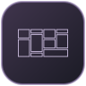
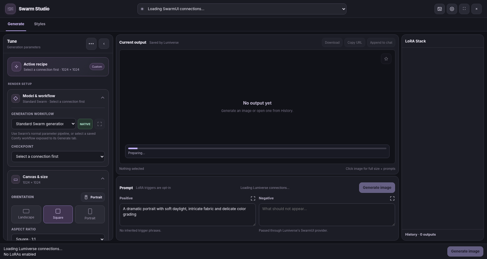
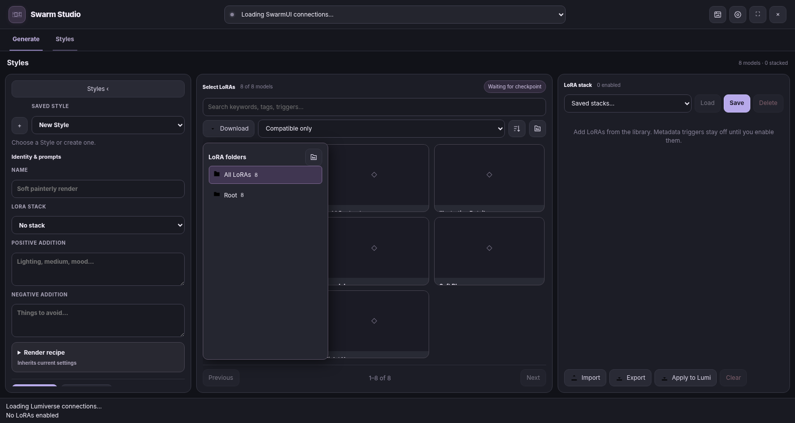
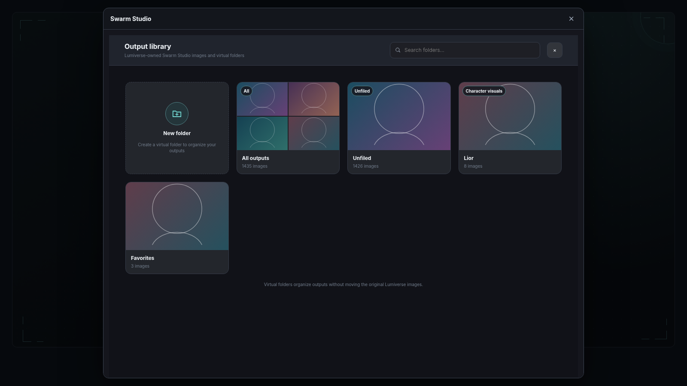
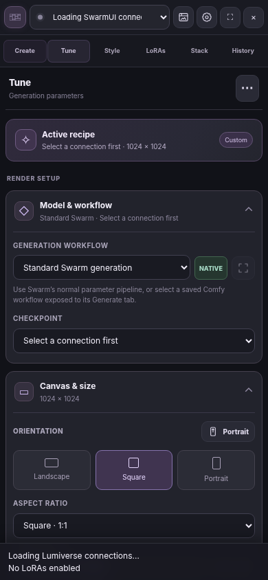
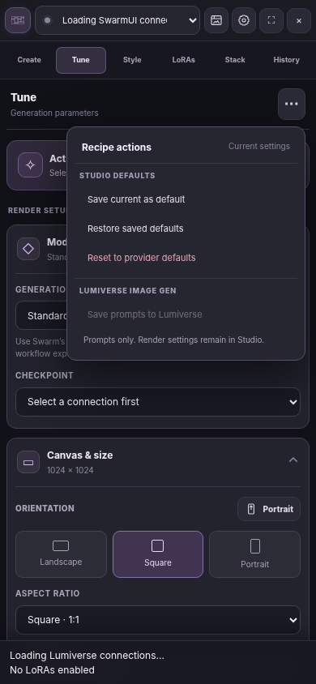

**1.1.0-alpha.12:** Finalize postproduction chains, same-seed Render Lab comparisons, SAM2-assisted Edit selections, Anima reference guidance and A/B composites, and discovered detector detailers. See [Postproduction](docs/postproduction.md).

**1.1.0-alpha.11.3:** Theme-aware range controls, independent scenery brightness/contrast grading and a compact responsive background gallery.

**1.1.0-alpha.11.2:** SVG-first Studio Edit properties, compact selection and edge actions, inline feathering and Select all.

**1.1.0-alpha.11.1:** Cast authoring guidance preserves speaker colors in both expression cards and ordinary dialogue, including continuations after narration and empty Genesis albums. No renderer or message storage changes.

**1.1.0-alpha.11:** Cast Atmospheres adds optional palette washes, gradient lighting and independent expression tint to scene presentations, with live previews and motion disabled by default. See [Cast Atmospheres](docs/cast-atmospheres.md).

**1.1.0-alpha.10.3:** Floating Expression Studio gallery actions replace the floating stage navigation, with Select all, Deselect all, custom expressions and generation settings available while scrolling.

**1.1.0-alpha.10.2:** Responsive wardrobe Move expressions gallery with persistent controls and selection count.

**1.1.0-alpha.10.1:** Inline image actions recover after failed regeneration when the previous committed attachment can be verified. Active and ambiguous targets remain protected.

**1.1.0-alpha.9.4:** Genesis character-design guidance separates stable outfit and expressive temperament from per-slot emotions and poses. Cast Recipe includes an optional appendable example for extra sidecar instructions.

**1.1.0-alpha.9.3:** Self-contained Expression Studio generation settings, floating stage navigation and optional local green/blue edge despill. See [Expression Workshop](docs/expression-workshop.md).

**1.1.0-alpha.9.2:** Brush and eraser previews, independent selection undo/redo, local Liquify Push, opt-in Genesis Anima Ref anchoring, and responsive inspector tools. See [Studio Edit](docs/studio-edit.md) and [Cast Genesis](docs/cast-genesis.md).

**1.1.0-alpha.9.1:** Recover malformed opted-in count attributes from validated structured plans and favor focal compositions. See [Explicit count](docs/prompt-compilers/explicit-count.md).

**1.1.0-alpha.9:** Studio Edit brings local transparency cleanup, magic wand, selection refinement, despill, cropping, transformations and existing AI tools into a responsive artwork workspace. See [Studio Edit](docs/studio-edit.md).

**1.1.0-alpha.8.6.4:** Floating artwork preview adapts its chrome to its own dimensions, with compact icon controls, quiet progress and unobstructed artwork.

**1.1.0-alpha.8.6.3:** Cast Recipe and Expression Studio shared positive prefixes now offer a native Swarm preset picker alongside free text.

**1.1.0-alpha.8.6.2:** Native reference uploads and Lumiverse image URLs now resolve original image bytes through the account-scoped SDK, independent of thumbnail flags. Existing extension-owned output permissions remain unchanged.

**1.1.0-alpha.8.6.1:** Expression Studio settings use a compact, responsive drawer with aligned controls, visible slider tracks and a persistent Done footer.

**1.1.0-alpha.8.6:** Cast Recipe gains aspect presets, linked dimension sliders, exact pixel inputs, sampler/scheduler dropdowns and named saved-workflow inputs. See [Cast Recipe](docs/cast-recipe.md).

**1.1.0-alpha.8.5:** Cast Recipe captures a house style for Genesis and Expression Studio, including LoRA weights, appearance direction and extra sidecar instructions. Authoritative Cast save signatures and scoped member removal protect concurrent generated assets. See [Cast Recipe](docs/cast-recipe.md).

**1.1.0-alpha.8.4:** Live Genesis production inside the member Expressions grid; pending tiles become registered artwork in place. Passive Cast browsing no longer writes the library.

**1.1.0-alpha.8.3:** Prompt-only Genesis and image-header geometry recovery for enhancement and background removal. Existing jobs can Resume. See [Cast Genesis](docs/cast-genesis.md).

**1.1.0-alpha.8.2:** Optional grouped character count reinforcement and explicit user scope on Genesis/parser sidecar requests. See [Explicit count](docs/prompt-compilers/explicit-count.md) and [Cast Genesis](docs/cast-genesis.md).

**1.1.0-alpha.8.1:** Auto now selects the authoring dialect as well as the final compiler, with conservative Anima composition normalization and diagnostics. See [Auto authoring](docs/prompt-compilers/auto-authoring.md).

**1.1.0-alpha.8:** Cast Genesis, opt-in automatic member production from completed dialogue packets. The configured parser designs one reusable identity and the existing expression pipeline creates permanent Cast assets. See [Cast Genesis](docs/cast-genesis.md).

**1.1.0-alpha.7.5:** The Cast album presentation library now has a persistent category directory, searchable gallery, compact mobile navigation, on-demand framing, and repeated look selection without closing. See [Presentation Library](docs/presentation-library.md).

**1.1.0-alpha.7.4:** Restores the visual identities of scene presentations, differentiates speaker and expression styling, and refines the catalogue. See [Cast design audit](docs/cast-design-audit.md).

**Overlap family redesign (v1.0.49):** The four **Portrait + dialogue overlap** presets no longer share the same generic dark speech box silhouette. **VN Hero Stage**, **Corner Pop-Out**, **Angled Cutout**, and **VN Standee** were rebuilt with distinct markup and materials so each design has its own bubble language while preserving the overlap premise, authored dialogue color, and stage-side controls.

**1.1.0-alpha.7.3:** Member Atelier adds a centered canvas, visual presentation and expression pickers, a contextual tool rail, and member-wide user presentation preferences with independent card-specific expression corrections. See [Member Atelier](docs/member-atelier.md).

**1.1.0-alpha.7.1:** Desktop joins the connected workspace tabs; Generate/Stop uses the active accent and contrasting ink.

**1.1.0-alpha.7:** Mobile workspace tabs and shared generation footer, full-height drawer, scaled background dialogs, background job feedback and a compact protocol editor. See [Studio polish](docs/studio-polish.md).

**1.1.0-alpha.6:** MOSS Swarm BBox and native JSON modes for structured inline/Pocket scenes, exact text items in native JSON, and provider architecture discovery for Auto. See [MOSS transports](docs/prompt-compilers/moss.md).

**1.1.0-alpha.5:** Select saved visual identities in Lore for manual generation, with multi-book selection and a compact grouped provenance popover in Generate. See [Manual Lore](docs/prompt-compilers/manual-lore.md).

**1.1.0-alpha.4:** Cast backgrounds can be generated manually or from opted-in completed dialogue replies, with isolated environment-only prompts, shared Background Assets references and live stage refresh. See [Cast background generation](docs/cast-background-generation.md).

**1.1.0-alpha.3:** Visual Lore becomes scene-scoped, with model-family overrides and contribution diagnostics. Native activation alone no longer injects visual lore into tagged or Pocket generation. See [scope and migration](docs/prompt-compilers/visual-lore.md).

**1.1.0-alpha.2.8:** Lore follows native folders, loads complete paginated libraries, and uses consistent entity classification. Generate binding pills distinguish enabled from disabled. See [Lore Atelier](docs/visual-lore-atelier.md).

**1.1.0-alpha.2.7:** Persona gains a dedicated profile directory and compact prompt editor, with a mobile profile rail. See [Visuals workspace](docs/visuals-workspace.md).

**1.1.0-alpha.2.6:** The Visuals drawer gains shared settings shortcuts, collapsed binding cards, active Cast and Styles navigation. The missing `world_books` manifest permission is restored; approve it in Lumiverse if prompted. See [Visuals workspace](docs/visuals-workspace.md) and [Lore](docs/visual-lore-atelier.md).

**1.1.0-alpha.2.5:** The decorative Swarm drawer entrance is restored. Its Visuals button opens a separate quick-access screen with expandable Character, Persona and LoRA preset controls, plus Back and a link to the full editor. See [Visuals workspace](docs/visuals-workspace.md).

**1.1.0-alpha.2.2:** Visuals adopts compact look/profile cards, prompt-first editors, expandable secondary settings and separate save footers. The Visual Lore tab is now **Lore**. See [Visuals workspace](docs/visuals-workspace.md).

**1.1.0-alpha.2.1:** Chat Visuals now lives in Studio rather than the drawer. Character identity, LoRAs, looks and persona profiles share a spacious responsive workspace. See [Visuals workspace](docs/visuals-workspace.md).

**1.1.0-alpha.2:** Visual Lore has a dedicated Studio workspace next to Cast. See [Visual Lore Atelier](docs/visual-lore-atelier.md) for library navigation, activation states, editing, reference selection and testing. Prompt compilation and lore injection are unchanged from alpha.1.

**1.1.0-alpha.1:** Model-aware inline prompting foundation. See [compiler documentation](docs/prompt-compilers/README.md) for modes, ownership syntax, migration, diagnostics, and the remaining MOSS layout integration gate. The stable visual rollback baseline is 1.0.53.

**Cast Material Edition final palette fitting (v1.0.48):** The 12 redesigned layouts now have independent material-tint recipes, each with its own base ink/paper colors and speaker-color intensity. Soft dialogue plates are mixed toward black for readability, while Agency Lanyard and Gothic Folio keep light physical surfaces with separately dark caption wells. The canonical values live in `scripts/cast-material-redesign.css`, not a late override. Preview all twelve with Mina-pink, Shoto-blue and Katsuki-orange in `docs/screenshots/cast-material-three-voices-v48.png`. `python tests/cast-material-tint-v48-browser.py` tests the three authored colors against actual rendered CSS-derived surfaces; 72 cases pass with at least 4.84:1 sampled contrast at 320px and 760px. Other authored colors and live host themes still warrant visual checks. The original Cast Islands and the three locked Atelier references are not modified.

**Cast Material Edition (v1.0.46):** Twelve of the most repetitive navy/charcoal Cast wardrobe layouts were rebuilt as actual new HTML compositions, not re-skinned cards: VN Hero, Corner Pop-Out, Angled Cutout, VN Standee, Tech Messenger, Agency Lanyard, Cyber Comms, 16-Bit RPG, Gothic Folio, Mecha HUD, Terminal Console and Cinematic Bleed. Their editable markup lives in `scripts/cast-material-redesign.json`; their canonical surface rules live in `scripts/cast-material-redesign.css`, both compiled by `scripts/build-cast-presets.py`. Source styling for their retired panels is not shipped. Speaker color now affects material gradients, accents and decorative frames while authored dialogue color remains exact. Auto/Left/Right, image crops, and one-image/one-dialogue slots remain supported. Approved Atelier layouts were not changed. For browser verification run `python tests/cast-material-edition-browser.py` (216 responsive/side/color scenarios) and `python tests/cast-stage-geometry-browser.py` (306 catalog scenarios). See `docs/screenshots/cast-material-edition-v46.png` for the real compiled-component contact sheet.

**Cast Wardrobe palette audit (v1.0.45):** Several contributed presets retained blue-black surfaces even after their Shoto-blue border accents were replaced. Canonical preset generation now uses neutral charcoal/ink panels while keeping the authored dialogue color exact and letting the speaker's color tint ornaments. The approved Chapter Tab, Moonlit Halo and Polaroid Side Note references are unchanged. Run `python scripts/build-cast-presets.py` after editing the source CSS and `python tests/cast-neutral-palette-browser.py` to verify the compiled result.

**Expression Studio Workflow Health (v1.0.44):** The **Enhance → Upscaler model** and **Background removal → BiRefNet model** checks now use the same `src/studio/workflow-health.ts` component. A future model check supplies its title, initial status, check callback, and optional install/download actions; the component provides the theme-aware status rail, accessible status updates, button layout, state styling, and action visibility. **Check model** remains available when BiRefNet is ready, while install/download help hides until needed. The two backend checks and saved workflow behavior are unchanged. Browser regression: `python tests/workflow-health-browser.py` (390px and 1200px).

**Cast material contrast tuning (v1.0.47):** The twelve redesigned Cast Material Edition presets now mix speaker color more aggressively with black/ink on their soft tinted surfaces. VN Hero, Corner Pop-Out, Angled Cutout, Tech Messenger, VN Standee, Agency Lanyard, 16-Bit RPG, Gothic Folio, Mecha HUD, and Cinematic Bleed keep their rebuilt silhouettes, but their panel bases and shared copy/UI tokens are darker and more clearly separated for readability. Dialogue colors remain authored by the host; this patch only tunes the underlying component materials.

**Expression Studio unified model ribbons (v1.0.43):** The AI Upscale and built-in BiRefNet checks now share the same accented ribbon presentation in **Expression Studio → Enhance** and **Background removal**. Both use the same label hierarchy, status copy styling, button sizing, and accent rail, while keeping their own workflow-specific actions and backend state messages. Missing or unavailable models still switch to warning/neutral states; the change is visual unification, not a behavior change.

**Expression Studio upscale preflight (v1.0.42):** Open a character or Cast member's **Expression Studio → Enhance**. The **Upscaler model** ribbon checks the AI Upscale model saved for your selected SwarmUI connection. **Check model** verifies that SwarmUI's model registry lists that exact model; the ribbon reports missing or unavailable models instead of assuming an arbitrary downloaded weight is ready. Configure or change the selection from **AI Upscale** on any saved Studio output, choosing **Remember this setup for this SwarmUI connection**, then return and check again. Saved/custom workflow modes do not expose a single model to verify. The check does not install or modify models.

## 2026-11-22 · Cast album management and gallery stage preview (1.0.37)

- **Rename saved expression keys:** Hover or focus an expression tile and choose the pencil. Rename rekeys the Cast image mapping without changing its image ID, updates the fallback/packet selection when appropriate, and rejects duplicate names before writing. The original Lumiverse image and character card remain untouched. Historical chat messages with the old packet key are not rewritten.
- **Remove individual expressions:** Each tile has a small X action (always visible on touch). Confirmation removes only the Cast mapping. If the deleted expression was the member's fallback, Cast selects `neutral` when available or the next saved expression. Deleting the last expression safely leaves an empty album. Member deletion remains at **Identity → Remove member**.
- **Lumiverse character avatars:** From Lumiverse character now displays thumbnail images from `/api/v1/characters/:id/avatar?size=sm`; unavailable avatars fall back to the character's initial. Import still copies mappings without editing the source card.
- **Stage position in the wardrobe gallery:** Auto / Left / Right now appears above the full presentation catalog. Switching it redraws every visible preset thumbnail with the saved per-member side, so asymmetric and center-based compositions can be evaluated in the picker itself. The composition filter and shared crop workshop remain intact.
- **Verification:** `python tests/cast-album-management-browser.py` exercises the compiled frontend and a minimal mock Lumiverse backend for key rename, duplicate rejection, fallback deletion, all preset previews, side save and filter persistence, avatar fallback and card import. TypeScript and Cast contracts pass. No Cast Islands/Shadow DOM/packet pipeline changes.

## 2026-11-22 · Cast quick-swap polish (1.0.36)

- **Text alignment belongs to Cast:** Shadow-root host and dialogue get a left-aligned baseline, preventing justified host MessageContent CSS from spreading word spacing across cards. Named presets can still apply their own intentional alignment.
- **Legacy Story Card retired from selection:** hidden in the quick swap and Studio wardrobe; historical saved Story Card selections still render. Newly created casts default to Manga Chapter Tab.
- **Mobile-safe quick swap:** the search field starts hidden and unfocused. A dedicated SVG magnifier beside the composition dropdown toggles it; the soft keyboard is only requested after a deliberate tap.
- **Per-member side in quick swap:** Auto / Left / Right saves only the current Cast member via `set_cast_side`. Other members, expressions and original messages are unchanged.
- **Direct navigation:** the quick menu's compact footer opens the clicked member directly at Cast → Presentation, including when the Studio library must be loaded asynchronously. The general Studio/Generate landing path is bypassed.
- **Crop controls decluttered:** removed the unpreviewable crop sliders from Member → Presentation. Both the full wardrobe modal crop workshop and the quick swap Crop tab remain available, sharing the same saved framing.
- **Tests:** added `tests/cast-quick-polish-browser.py` with a hostile justified host, mobile search, targeted side save, direct navigation, and preservation of the existing wardrobe. Backend storage isolation is covered in `backend-contract.mjs`.
- **Boundary:** Cast Islands' display-only source transform, Shadow DOM hydration/remount, and saved expression keys are unchanged. Rebuild both `dist` entrypoints when installing.

**Cast member stage position (v1.0.34):** Open **Cast → Member → Presentation** and choose **Auto / Left / Right** under Stage position. The selected side applies to the entire member, across all their expression images, while other characters keep their own placement. Auto preserves each presentation’s natural layout; artwork is repositioned, never mirrored. The per-expression controls have been removed. The full wardrobe modal, two-column member view, expression imports and Cast Islands renderer remain unchanged. Libraries with unanimous older side choices migrate safely; conflicting or partial choices reset to Auto.

**Cast expression packs (v1.0.32):** In Cast, open a member’s Expressions studio and choose **Import pack** for PNG/JPEG/WebP files or a ZIP. Filename-derived keys (including underscores and numbered labels) are preserved exactly; readable labels are display-only. Files are attached only after the member’s Cast save succeeds. A failed Cast save does not mean the image upload failed: the Studio retains the local assignments for a retry. The old Cast Islands v2 pre-render renderer is unchanged.

### Cast Islands v2 (1.0.31)

Cast now uses the official Lumiverse **display-only render content processor**, replacing complete closed Cast tags with native HTML slots **before Markdown/sanitization**. After render, those slots hydrate into Shadow DOM presentations. The old post-render source-guessing, narration recovery, and text-node slicing code is gone. Studio layouts, the right-click Looks/Crop picker, member library, and 34 named presets remain.

**Host requirement:** `spindle.registerMessageContentProcessor` must be available with the `render` origin. This build feature-detects the hook but intentionally has no unsafe legacy fallback. For browser and source-order regression coverage see `tests/cast-island-pipeline-contract.mjs` and `tests/cast-island-api-browser.py`. Actual Lumiverse live rendering still needs verification.

### Cast narrative placement

Cast v1.0.30 preserves closed-packet source order through sanitizer commits. Missing connective prose is recovered only in verified narrative bodies and ordered with its portraits between uniquely matched native paragraphs. It never guesses mid-word insertion points or repairs another extension's hidden payload. The permanent Chromium check is `python tests/cast-r31-narrative-sequence-browser.py`.

## Cast v1.0.29: source guesses no longer cut native prose

When Lumiverse sanitizes Cast delimiters, their original character offsets are lost. An earlier fallback used the nearest source-position *estimate* to split a native text node, sometimes placing the expression halfway through a word in Katsuki's narration. Cast already has Shadow DOM islands for presentation isolation; v1.0.29 makes their anchors block-safe. Exact full packet delimiters may be consumed at a character position; stripped/partial packets are placed only beside a verified native prose paragraph, never inside it. If that safe block doesn't exist, the expression is skipped rather than damaging the story. Existing narrator recovery, route-widget isolation, source pinning, progressive token handling, crop and wardrobe remain unchanged. Regression: `python tests/cast-r30-island-anchor-browser.py` (red on 1.0.28, green here). Actual Lumiverse livetest is still necessary.

### Cast v1.0.28: settled expressions do not reflow on stale host projections

Cast now pins the first completed expression source for an unchanged message, rather than choosing between intermittently sanitized/saved host snapshots. If the source, owned mounts, actual native prose and wardrobe version are unchanged, it performs **zero DOM writes** on repeat host events. A different message streaming does not awaken settled Cast cards. Real edit/swipe events, final stream handoff and changes to the saved presentation still update normally. Repro test: `python tests/cast-r29-stable-projections-browser.py`. A 16-event Chromium regression produced **160 writes before** and **0 after**. This has not yet been verified in the user's Lumiverse installation.

### Cast v1.0.27: recovered narration stays in the message body

Cast no longer uses the entire message container as a fallback insertion point for missing prose. A chat message can contain a prose bubble, controls, and a separate choice widget; Cast now recognizes native paragraph text as its placement anchor and refuses to put recovered text inside another extension's widget or below the chat bubble. Closed packets, authored colors, progressive streaming and the previous foreign-payload guard stay in place. If Lumiverse destroyed all useful prose anchors but left a visible foreign widget, Cast prefers not to reconstruct ambiguous text instead of leaking it into the UI. A purely sanitized empty message can still recover from its empty native paragraph sentinel. Regression: `python tests/cast-r28-bubble-recovery-browser.py`.

### Cast v1.0.26: no foreign widget payload resurrection

Cast's optional source-backed narration recovery is now **prose-only**. When another extension has rendered a UI widget from a structured block in the assistant's text, Cast will not add that raw block back underneath the widget. This includes branch records such as `1|@challenge|...`, HTML-comment-delimited extension payloads, and non-prose custom tags. Real missing prose outside closed Cast packets is still recoverable when it is unambiguously plain narration. In mixed control/prose segments, Cast deliberately leaves recovery to the owning extension rather than printing hidden payload data. No changes to the Cast packet grammar, preset designs, crop settings, Shadow DOM, or live-stream event handling. Regression: `python tests/cast-r27-foreign-payload-browser.py`.

### Cast v1.0.25: real streamed-token events and duplicate-free dialogue

Live Cast now uses Lumiverse's `STREAM_TOKEN_RECEIVED` deltas (`generationId`, `token`, `seq`) instead of assuming unsaved `getContent()` has already been updated. It binds a new stream to its actual provisional message bubble whether the host exposes escaped tag text or a Chromium-created unknown tag element, and only complete closed packets can mount progressively. Partial trailing packets remain hidden. The explicit `<swarm-cast=Member-expression>...</swarm-cast>` syntax and braille normalization are unchanged.

**No double dialogue:** The host may parse `<swarm-cast=...>` as an unknown HTML element without a matching close tag. Cast checks the native quote's matching element owner, adjacent literal opening delimiter, or substantial source context on **both sides** before consuming it. A quotation without provable packet ownership remains native and cannot also appear in a Shadow DOM caption. Intervening narration, unrelated same-text quotations, saved crop settings, and all wardrobe presets remain intact. Regression checks: `python tests/cast-r25-live-tokens-browser.py`, `python tests/cast-r26-no-duplicate-browser.py`, `python tests/cast-r26-unowned-quote-browser.py`, and `python tests/cast-r24-progressive-browser.py`. Actual Lumiverse streaming still requires a live test.

### Cast v1.0.24: progressive dialogue, prose recovery and bounded crop zoom

Closed Cast packets appear as soon as their **own closing tag** arrives, even during streaming. A partial in-flight packet is suppressed rather than printing raw `<swarm-cast>` text. No opening-only fallback is enabled. Normal narration is never consumed by fuzzy quote matching; if Lumiverse's HTML sanitizer already destroyed a paragraph nested inside an unknown Cast element, Cast conservatively restores the missing source narration between the correct expressions.

Zoom now stays **inside each preset's image viewport** instead of magnifying artwork across the chat and caption. Saved X/Y/zoom settings still belong to the member and are shared between Studio and the right-click Crop tab. `python tests/cast-r24-progressive-browser.py` and `python tests/cast-crop-focal-browser.py` validate these cases in Chromium. Rebuilt `dist/backend.js` and `dist/frontend.js` are included with the full cumulative source overlay. Back up your extension before extraction. A real in-app generation test remains necessary.

### Cast Wardrobe v1.0.23: strict closed packets and streaming stability

**This is a deliberately breaking Cast packet change for a single-tester setup.** Only complete `<swarm-cast=Member-expression>"Dialogue."</swarm-cast>` envelopes render. Opening-only / adjacent-quote tags no longer mount. Source parsing normalizes U+2800 braille blanks **in memory before tag and `<font color>` parsing**, without rewriting stored messages or surrounding native prose. Authored dialogue colors and ordinary text spaces survive. The source cache is cleared at the start of a new generation, including same-ID regenerations, so an old expression cannot haunt a new partial response.

**Historical v1.0.23 behavior, superseded by v1.0.24:** v1.0.23 waited until generation ended. In v1.0.24, completed closed packets appear during streaming and unfinished packets are hidden. Studio's copy/prompt use closed syntax. All presentation styles, crop tools, right-click picker and Shadow DOM isolation remain unchanged.

Regression: `node tests/cast-contract.mjs`, `node tests/cast-envelope-contract.mjs`, `python tests/cast-strict-r23-browser.py`, `python tests/cast-crop-focal-browser.py`. The former tests cover non-closed inert source and braille-colored quotes; the browser fixture covers two speakers, sanitized host HTML, stream-to-final recovery, stale same-ID cache rejection and no scroll-based Shadow DOM rewrites. Legacy R4-era browser fixtures still contain opening-only samples and are historical, not the strict contract. Back up your installation and extract the full overlay. To retain earlier chat expressions, rewrite those packets with explicit closing tags.

### Cast Wardrobe v1.0.22: crop position actually affects live cards

Fixed the mismatch where **Horizontal** and **Vertical** sliders saved new values but some donated preset styles overrode the live image focal position with their original CSS. With **Enable shared crop** checked, X/Y now take precedence inside the Shadow DOM expression card; with crop disabled, each design keeps its intended default composition. Zoom still uses the same shared member setting. Full transparent standees that intentionally use their complete uncropped artwork, including Moonlit Halo, do not acquire a fake viewport pan. Quick-picker, Studio crop editor, and bounded packets are unchanged. Test with `python tests/cast-crop-focal-browser.py`.

### Cast Wardrobe v1.0.21: bounded expression packets

New Cast generations now use `<swarm-cast=Member-expression>"Dialogue."</swarm-cast>` (optionally `<font color="#599CE3">"Dialogue."</font>` inside). The explicit closing tag determines dialogue ownership; narration and other characters' lines stay outside the packet. Studio's copy and preview examples use the same complete packet. The live Shadow DOM renderer recovers owned dialogue and color from the saved source after host sanitization, removes both literal delimiters when present, and retains the R4 no-scroll-repaint safeguards. As of v1.0.23, opening-only messages no longer render; rewrite them with closing tags. The Chromium regression also protects identical native quotes elsewhere in the prose.

### Cast Wardrobe v1.0.20: theme-proof live mounts and external expression packs

Cast's **live chat expression mounts now use Shadow DOM**. Host themes can style the surrounding prose and supply Lumiverse semantic tokens, but cannot reach the actual expression composition. Authored dialogue colors and the right-click Looks/Crop picker still work. Fighter Banner now uses a wider, quieter quote plate with its sprite layered above the backdrop. The Studio/gallery previews remain in their normal Studio DOM.

**Import external expression packs:** Cast → Member → Expressions → **Open expressions** → **Import pack**. Select multiple PNG/JPG/WebP files, or one or more ZIP archives. Image filenames become expression labels (e.g. `Shoto-joy.png` becomes `joy` for Shoto). Imports fill empty slots or create custom slots up to the existing set limit. Existing expression images are never replaced. The status line reports skipped duplicates and failed files. ZIP extraction supports stored and DEFLATE entries in modern Chromium; on older webviews, unzip the pack and select its image files instead. No new backend endpoints are required.

Regression commands (from extension root): `node tests/cast-presentation-contract.mjs`, `python tests/cast-shadow-r20-browser.py`, `python tests/cast-pack-r20-browser.py`, `python tests/cast-fighter-r20-browser.py`, `python tests/cast-wardrobe-r6-browser.py`, `python tests/cast-wardrobe-r7-browser.py`. Run `STUDIO_TSC=/path/to/typescript/bin/tsc npm run typecheck` where the local `node_modules` compiler isn't installed. **Back up your installed extension** before overlaying this full cumulative ZIP.

### Cast Wardrobe v1.0.19: right-click Looks / Crop fitting room

Right-click a live Cast expression to open a small two-tab editor. **Looks** remains the searchable, composition-filtered presentation picker. **Crop** shows the specific expression you clicked (with a selector for the member’s other saved expressions), a shared crop enable switch, a draggable preview, X/Y/zoom sliders, and **Reset framing**. The crop is saved to that Cast member, exactly the same field used by Studio’s existing crop workshop, not a per-message or per-style override. Cropped looks update after a backend acknowledgment; full transparent silhouettes remain intact. The original dialogue text is never modified.

The popup now uses Lumiverse/Studio surface, text, border, muted-text, and accent tokens rather than a hardcoded purple palette; controls and selection states follow both dark and light themes. The menu reclamps to the viewport when you switch tabs, even on a narrow screen. Frequent drag movements update only the temporary preview, not the live message or stored library; mouse release or slider change commits one member-only crop operation with queued last-write handling.

Checks: `node tests/cast-wardrobe-r8-contract.mjs`, `python tests/cast-wardrobe-r8-browser.py`, `python tests/cast-wardrobe-r6-browser.py`, `python tests/cast-wardrobe-r7-browser.py`, and `python tests/cast-r4-lifecycle-browser.py`. The normal Studio crop editor remains unchanged. This release is a cumulative overlay, so back up the installed extension before overwriting it.

### Cast Wardrobe v1.0.18: composition polish and crop workshop

In Cast → Member → Presentation, open **Choose a presentation** to browse looks by composition. The top of the modal now contains a crop workshop: enable shared framing, drag your saved expression in the crop well, or adjust X/Y/zoom. These values are saved to that member and reflected in cropped presentation previews. Transparent full-silhouette presets can stay uncropped. The modal's surfaces, text and borders inherit Studio's theme tokens.

Shonen Burst, Tarot Arch, VN Standee, Manga SFX, Persona Angular, Fighter Banner and Anime OVA have targeted geometry repairs. Neon Horizon now has a luminous grid distinct from Open Horizon's restrained editorial line. The approved Chapter Tab, Moonlit Halo and Polaroid are preserved. This is still a full source overlay; back up the installed extension before extraction.

Tests: `node tests/cast-wardrobe-r7-contract.mjs`, `python tests/cast-wardrobe-r7-browser.py`, `python tests/cast-presentation-browser.py`, `python tests/cast-r4-lifecycle-browser.py`. Regenerate contributed layout CSS with `python scripts/build-cast-presets.py` before building; never add late duplicate rules.

### Cast Wardrobe v1.0.17: quick switch and theme-aware labels

Right-click a mounted Cast expression in chat to open a small presentation picker. Filter looks by composition or search a name; selecting a preset updates only that member's saved style, without rewriting chat content. Clicking outside or pressing Escape closes the picker. The Cast workspace gallery fits full-size renderings uniformly into its preview frames, rather than changing individual parts of the composition. Decorative accents mix 30% of the authored dialogue color with neutral mauve-gray; the dialogue text itself keeps its exact authored color. VN Hero's nameplate uses Lumiverse surface/text theme tokens for dark and light contrast.

<div align="center">
  
  <h1>Swarm Studio</h1>
  <p><strong>Your SwarmUI workspace, right inside Lumiverse.</strong></p>
  <p>Prompt, tune, stack LoRAs, browse generations, and bring images into your chats—without switching applications.</p>
  <p><code>Spindle extension</code> · <code>Lumiverse 0.15.8+</code> · <code>SwarmUI / ComfyUI workflows</code></p>
  <p><a href="#installation"><strong>Install</strong></a> · <a href="#the-studio"><strong>Explore the studio</strong></a> · <a href="#what-it-does"><strong>Features</strong></a> · <a href="#documentation"><strong>Documentation</strong></a></p>
</div>

> **Inline generation reliability (v28):** The extension converts U+2800 Braille blanks to ordinary spaces in Gem-authored inline image prompts and both outgoing SwarmUI prompt fields. Replayed generation events and identical inline callback deliveries are deduplicated; explicit regenerate/retry still produces a new job. This is an outgoing-data fix, not a rewrite of existing chat text.

> **Floating toolkit (v27):** the original satin Locket opens a six-action rail: Quick Create, Full Studio, Preview, Recent Images, Append, and More. The small pin beside the orb keeps the rail open. Right-click/long-press the **orb** for its unchanged context menu; use the **rail’s `⋯`** for a separate toolkit menu with AI Upscale, Quick Create, Gallery, pinning, and panel reset. Quick Create has a draggable header and an in-panel render-settings screen (ratio, dimensions, sampler, steps, CFG, and seed). Preview stays independently open while Quick Create is in use, including on mobile. The easel uses real generation events.

---



<sub>Generate workspace · Actual v4 interface captured with an offline browser fixture. Connection-dependent content is unavailable in this preview.</sub>

Swarm Studio adds a full image-generation workspace to [Lumiverse](https://github.com/prolix-oc/Lumiverse) using the SwarmUI connection you already configure there. It **does not replace** Lumiverse's native inline image tools or take ownership of your saved connection secret.

## The studio

### Generate: the controls you need, where you need them

A three-part workspace keeps the **Tune** inspector, current output and prompt composer, and **LoRA stack** in view. Tune groups the real controls by task rather than presenting one endless settings form:

- **Model & workflow** — checkpoint selection, standard Swarm generation, and saved ComfyUI workflow parameters.
- **Canvas & size** — orientation presets, aspect ratios, linked dimensions, and scale.
- **Sampling & quality** — steps, CFG, seed, sampler, and scheduler.
- **Image-to-image & Advanced Swarm** — init images, denoise/creativity, preset stacks, model overrides, and raw request JSON when you need them.

The little **⋯** menu collects Studio defaults, character recipe actions, and Lumiverse prompt exports without burying the everyday controls beneath them. It preserves their different save/restore behavior.

### Styles: reusable looks and a real LoRA library



<sub>Styles workspace · The LoRA library and the active stack stay separate, so browsing never silently changes your generation.</sub>

Build named Styles with positive and negative prompt additions, optional render settings, and a selected LoRA stack. Browse compatible LoRAs, inspect metadata and previews, enable or reorder weights, opt into trigger phrases, and import/export shareable stacks. You can apply a stack to Lumiverse Image Gen as well.

### Output Library: your generations, properly organized



<sub>Output Library v10 · Offline browser fixture with 1,435 simulated outputs. Your own images and folders appear in the live extension.</sub>

The library keeps every original saved image in Lumiverse. Browse **All outputs**, **Unfiled**, **Favorites**, and virtual character or custom folders with bounded cover previews. Open a folder for a paginated, independently scrollable thumbnail grid; image details, favorites, bulk selection, and character Looks remain accessible. At phone widths, folder cards and image thumbnails use a two-column layout.

### Phone-sized without throwing away your work

<table>
  <tr>
    <td align="center" width="50%"></td>
    <td align="center" width="50%"></td>
  </tr>
  <tr>
    <td align="center"><sub><b>Tune on mobile</b><br />Compact cards, tappable controls, and preserved draft state.</sub></td>
    <td align="center"><sub><b>Recipe actions</b><br />Save and restore operations without an accordion maze.</sub></td>
  </tr>
</table>

The mobile studio uses **six persistent tabs:** **Create · Tune · Style · LoRAs · Stack · History**. Switching tabs preserves prompt drafts, loaded LoRAs, and other in-progress settings. The image-to-image picker lives in **Create** on narrow screens, and Generate remains within easy reach.

## What it does

| Create & iterate | Keep images organized | Bring visuals into Lumiverse |
| --- | --- | --- |
| Positive/negative prompts, checkpoints, sampler, scheduler, CFG, seed and aspect controls | Chat-scoped history, output details, reuse parameters, favorites and folders | Append finished images to chat, per-character visual bindings, named Looks and Visuals controls |
| Live previews and interrupt support when Lumiverse exposes streaming | Full-size inspection, verified Swarm-path downloads when available, original metadata preservation | Optional `<swarm-image>` message tags, one-pass or parser-model image requests |
| img2img and saved SwarmUI/ComfyUI workflows | Searchable LoRA library, weighted stacks and portable JSON | Quick Create floating player, Lumiverse Image Gen stack handoff, `{{last_genned}}` macro |

The Studio also includes metadata-aware LoRA downloading, stack presets, native prompt editors, customizable appearance, and visual lore integration on supported Lumiverse builds. For the precise behavior and integration requirements, see the [full feature reference](docs/feature-reference.md).

## Installation

**Before you start:** You need Lumiverse **0.15.8 or newer**, a working **SwarmUI image-generation connection** in Lumiverse, and permission to enable a Spindle extension. ComfyUI workflows are accessed through SwarmUI's saved workflow interface; a separate direct ComfyUI connection isn't required for Studio.

1. In Lumiverse, open **Extensions / Spindle** and install Swarm Studio from its GitHub source or an extension archive/folder.
2. Enable **Swarm Studio** and approve the requested permissions. The manifest lists them in [`spindle.json`](spindle.json).
3. Confirm your existing **SwarmUI** connection works in Lumiverse. When no explicit URL is set, Lumiverse's default is `http://localhost:7801`.
4. Open **Swarm Studio** from its drawer entry or the chat input's **Extras** menu. Pick a checkpoint, enter a prompt, and generate.

**Using a source ZIP?** The package includes the compiled `dist/frontend.js` and `dist/backend.js` expected by Spindle; you do **not** need to build it just to install it. For a manual replacement, back up the existing extension directory and extract the complete source over it. Restart/reload Lumiverse as appropriate for your installation.

If a previous GitHub-source installation failed partway through, stop Lumiverse and remove the incomplete `data/extensions/swarm_studio` directory before retrying. See [GitHub source installation notes](docs/feature-reference.md#github-source-installation).

## A few useful details

**Generation and authentication.** Image creation continues through Lumiverse's SwarmUI provider. Streaming uses `spindle.imageGen.generateStream()` when available, with a non-streaming fallback. Lumiverse's connection secret is never exposed to the extension; if SwarmUI restricts *metadata* access, Studio supports a separate encrypted metadata-only token in Settings.

**Connected features vary.** LoRA previews, checkpoints, saved presets, workflows, and original-file downloads depend on the APIs and metadata your SwarmUI server exposes. Character-editor Visuals integration and automatic in-message image interception require the corresponding Lumiverse host capabilities. Core Studio generation remains available when optional integrations are missing.

**No surprise downloads.** Importing a LoRA stack does not automatically download its missing models; transfers require an explicit action.

### AI Upscale workbench (v25)

**One-time setup:** SwarmUI needs a running ComfyUI backend (usually **Server → Backends → ComfyUI Self-Starting**), and your SwarmUI account must be allowed to run dynamic Comfy workflows. To use the recommended **AI upscaler** mode, place an actual super-resolution model file such as [RealESRGAN_x4plus_anime_6B.pth](https://github.com/xinntao/Real-ESRGAN/releases/download/v0.2.2.4/RealESRGAN_x4plus_anime_6B.pth) (anime illustrations) or [4x-UltraSharp.pth](https://huggingface.co/Runware/upscaler/resolve/main/4x-UltraSharp.pth) (general illustrations) in **`<SwarmUI model root>/upscale_models/`**. The model root is configured in SwarmUI's model path settings; check it rather than guessing your install path. Restart/refresh SwarmUI's ComfyUI backend so it sees the newly installed model. Studio does **not** silently download or install checkpoints.

Open a saved PNG/JPEG/WebP in **Studio → Output inspector → AI Upscale**. The new workbench offers three paths:

- **AI upscaler (recommended):** Discovers models actually installed through SwarmUI's `ListT2IParams`, recommends an anime-specific model if one is present, and defaults to **2×** output. Select **3×** or **4×** as needed. The pipeline executes `SwarmLoadImageB64 → UpscaleModelLoader → ImageUpscaleWithModel → ImageScale → SaveImage`. The final `ImageScale` step only resizes the *AI-enhanced* result to the exact desired dimensions; enhancement itself runs through the selected model. No fake model fallback to Lanczos.
- **Saved workflow:** Lists saved SwarmUI Comfy workflows and lets you choose an explicitly **exposed image input**. The saved workflow decides its own enhancement steps and final output dimensions; Studio sends the source image to that exposed input. Your SwarmUI account needs permission to read and execute saved workflows.
- **Custom graph:** Paste or import a **ComfyUI API-format** JSON graph (not Comfy's visual/UI-layout export). It must have exactly one `SwarmLoadImageB64` input node and one `SaveImage` output node; Studio injects the saved image and output filename prefix. All graph nodes must be installed and permitted on your own ComfyUI backend. Graphs are limited to 128 KB / 150 nodes.

Choose **Remember this setup** to save your recipe per SwarmUI connection. Studio preserves the original image and saves a new result to the Output Library, normally beside the source in its folder. Owned input images must be no larger than 4096 px on either axis. Model-mode outputs are capped at 8192 px on either axis and at 36 megapixels; custom workflows have their own dimensions and VRAM requirements. Lumiverse must grant the extension **Images**, **Image Generation**, and (for discovery/validation) **CORS Proxy** permissions. The live generation uses Lumiverse's existing image-gen provider connection, not a separate ComfyUI URL.

**Compatibility note:** The separate inline chat-image *Finalize* action now reuses a remembered AI upscale recipe when one exists. Older installations without a saved AI recipe retain their previous 2× Lanczos inline-finalize behavior; the Output Inspector's **AI Upscale** button never substitutes Lanczos for a missing model. If discovery shows no models, verify the file location, restart/refresh SwarmUI, and reopen the workbench.

## Documentation

| Guide | What's inside |
| --- | --- |
| [Full feature & technical reference](docs/feature-reference.md) | Image-tag protocols, authentication, LoRA downloading, character looks, output library, macros, workflow parameters, and runtime behavior |
| [Studio workspace architecture](docs/experimental-studio.md) | Source map, mobile pane ownership, host integration, and browser diagnostic notes |
| [v4 redesign notes](REDESIGN_V4_README.md) | What changed in the source-aware visual rebuild and which checks were run |
| [Changelog](CHANGELOG.md) | Detailed feature and compatibility history |

## Development

The checked-in bundles are the runtime entrypoints. **When editing source**, rebuild them before packaging or committing:

```sh
# Node.js 23.6+ for the source build
npm run build

# For development/testing, install the declared dev dependencies
npm install
npm test
npm run typecheck
```

The package has no runtime dependencies. The optional browser suite is `npm run test:browser`; interactive UI diagnostics may require a configured Chromium/Playwright environment and suitable host fixtures. Debug messages use the `[Swarm Studio]` prefix in browser and Lumiverse server consoles.

---

<div align="center">

**Built for the space between a generation and the story it belongs to.**

<sub>Swarm Studio is a Lumiverse extension. SwarmUI and Lumiverse are separate projects.</sub>

</div>


## Cast expressions

See [Cast expressions](docs/cast.md) for reusable member/persona sets, narrative tags, deployment formats, and presentation options.

### Cast composition wardrobe (v1.0.16)

Cast → Member → Presentation opens a grouped gallery with 37 options, including the original Story/Sticker/Portrait modes and 34 source-preserved designs from the approved Atelier and contributed doctypes. The modal previews the member’s own expression, uses the existing shared crop settings, and stores member/cast defaults in the same version-2 Cast library. See `docs/cast.md` for design sources, regeneration, and no-jitter browser checks.


### Cast Worlds (v1.0.50)

Cast groups can now share saved backgrounds. Open a Cast group, choose **Backgrounds**, and add an owned image. Set a default or use `background=plaza` in an existing Cast packet. Choose a scene-backed presentation to display it. See [Cast Worlds usage and design notes](docs/cast-worlds-v1.md).


### Cast Wardrobes (alpha.10)

Open a member's Expressions page to create or edit outfits, move existing expressions, or open the workshop for the selected outfit. Each wardrobe owns its outfit prompt, reference and expression set while sharing the member identity and Cast Recipe. Existing keys and image IDs survive migration. See [Cast Wardrobes](docs/cast-wardrobes.md) for migration, packet syntax, fallback behavior and testing.
