<div align="center">
  
  <h1>LumiSwarm Studio</h1>
  <p><strong>Make the art. Build the cast. Bring your stories to life.</strong></p>
  <p>A complete SwarmUI creative workspace inside Lumiverse.</p>
  <p>  </p>
  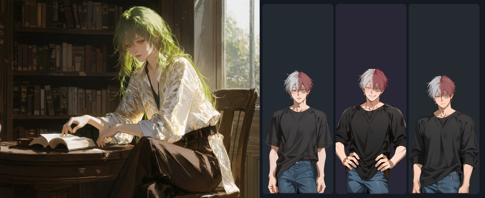
  <p><a href="#installation"><b>Install</b></a> · <a href="#the-studio"><b>Explore Studio</b></a> · <a href="#cast-your-story"><b>Cast</b></a> · <a href="#story-theater"><b>Theater</b></a> · <a href="#postproduction"><b>Finalize & Edit</b></a> · <a href="#documentation"><b>Guides</b></a></p>
</div>

LumiSwarm is a Spindle extension for [Lumiverse](https://github.com/prolix-oc/Lumiverse), built around your existing [SwarmUI](https://github.com/mcmonkeyprojects/SwarmUI) connection. It brings image generation, character expression production, visual lore, interactive dialogue presentations, cinematic story playback and image postproduction into one responsive workspace. Generate a single CG, build an entire character's wardrobe, or let your roleplay gradually produce its own reusable visual assets.

It does not replace Lumiverse's native image generation tools. It works alongside them, with existing connection credentials and account-owned images.

> **Current release: 1.1.0-alpha.17.13 (prerelease).** Optional capabilities depend on the installed Lumiverse runtime, SwarmUI backend, models and node packs. [Release history](CHANGELOG.md) · [Theater validation](docs/story-theater-validation.md)

**Prompt caching:** Studio settings / Generation / Inline images / History image markers lets you keep compact captions indefinitely or strip them immediately from outgoing context. Neither mode ages out captions mid-history. Saved illustrations remain intact.

## At a glance

| Create | Develop | Tell the story |
| --- | --- | --- |
| Manual generation, img2img, saved workflows | Finalize chains and Render Lab comparisons | Inline story illustrations and CGs |
| Styles, LoRA stacks, presets and recipes | Smart Selection, local editing, AI inpainting and upscale | Character and persona visual bindings |
| Model-aware prompt compilation and reference conditioning | Detailers, background removal and despill | Cast expressions, outfits, reusable scenery and atmospheres |
| Floating Quick Create and live preview | Library, provenance and Vacuum review | Automatic Cast Genesis and background production |
| | | Interactive Story Theater: visual novel playback, live replies, art direction and stage cues |

## Installation

**Requirements:** Lumiverse **0.15.8+** (manifest minimum), a working SwarmUI image generation connection and permission to enable Spindle extensions. Newer optional integrations may require a newer host. A direct ComfyUI connection is not required; Studio uses SwarmUI's backend and workflow transport.

1. Open **Extensions / Spindle** in Lumiverse and install the [LumiSwarm Studio repository](https://github.com/kittyafterdark/LumiSwarm-Studio) or a packaged extension archive/folder.
2. Enable **Swarm Studio** and review its requested permissions in [`spindle.json`](spindle.json).
3. Confirm your SwarmUI connection works in Lumiverse. If its URL is blank, Studio uses the existing default `http://localhost:7801`.
4. Open Studio from its drawer entry or the chat input **Extras** menu. Choose your checkpoint and generate.

Packaged releases contain the compiled `dist/frontend.js` and `dist/backend.js` entrypoints. No source build is necessary for installation. Back up your installed extension and its user data before applying a cumulative update; do not replace the data directories with source files. Reload/restart the extension or Lumiverse as appropriate.

For source installation troubleshooting and permission details, see the [technical reference](docs/feature-reference.md#install). For optional provider components, see [compatibility](#compatibility-and-provider-setup).

## The Studio

### Generate

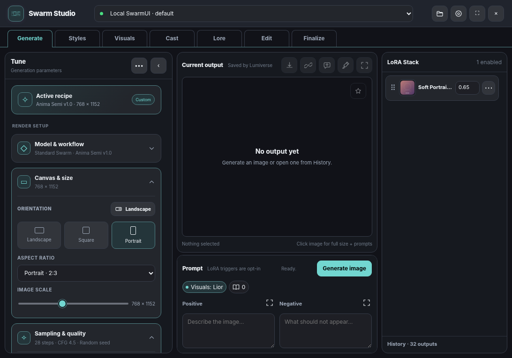

A full generation workspace with positive and negative prompts, checkpoint and saved workflow selection, linked canvas dimensions, sampler, scheduler, steps, CFG and seed. Use an existing output or uploaded image as an init image, control creativity, stack native Swarm presets, and access model-component overrides and raw request JSON when needed.

Live progress and preview frames appear when supported by the host/provider. Reuse a previous image's recorded parameters, inspect its prompt and metadata, favorite it, or append it to the active conversation. Generation uses Lumiverse's existing provider connection.

**Reference conditioning.** Compatible Anima Ref installations expose independent reference guidance and guidance end controls, without tying them to text CFG. Choose one saved reference or stitch A/B references into a single composite for paired character conditioning. This is not two independently weighted adapters. [Reference and refinement guide](docs/postproduction.md#reference-conditioning-in-generate).

### Styles & LoRA library

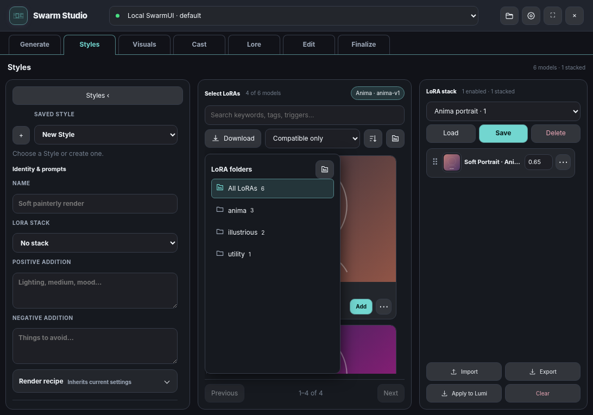

Create named Styles that combine prompt fragments, optional rendering settings and LoRA stacks. Browse compatible installed LoRAs by folder or keyword, preview model metadata, inspect triggers, and assemble ordered weighted stacks with per-item enablement. Import/export stack JSON and apply compatible stacks to Lumiverse Image Gen. Missing model downloads require explicit user action.

Saved Swarm presets and workflow parameters are available without leaving the workspace. Character recipes, Styles and Cast Recipes make repeatable art direction possible without copying yesterday's prompt into everything.

### Quick Create, floating toolkit & mobile

<table>
<tr>
<td align="center" width="50%">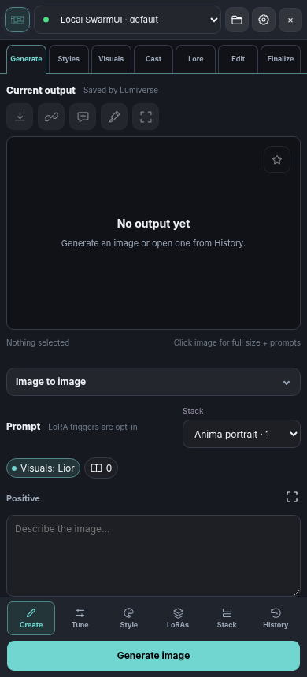</td>
<td align="center" width="50%">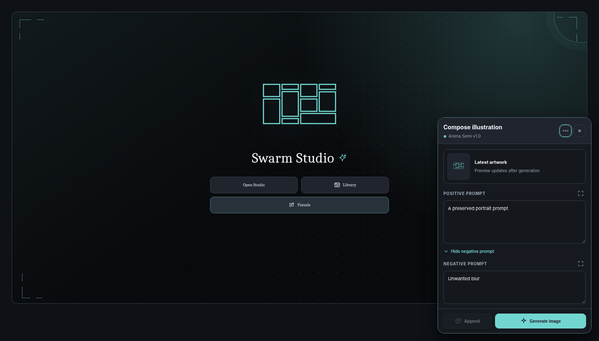</td>
</tr>
<tr><td align="center"><sub>Alpha.12 mobile Studio</sub></td><td align="center"><sub>Quick Create · earlier UI capture</sub></td></tr>
</table>

Studio adapts to phones, with persistent workspace tabs, a compact generation toolbar, and retained drafts. The draggable floating Locket gives quick access to prompt creation, preview, recent images, Library and Append while you stay in the conversation. Theme-aware colors, adjustable geometry, opacity and custom CSS let the workspace blend into your Lumiverse setup.

## Art that belongs to the story

<table><tr><td width="48%">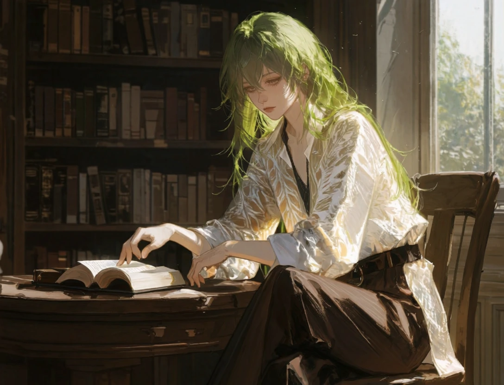</td><td><strong>Generate directly in the conversation.</strong><p>Optional image-tag protocols let the roleplay model request an illustration of the current moment. Use a complete inline prompt or let a separate parser model translate the scene into an image request. Keep the roleplay model focused on writing while Studio handles render settings and prompt compilation.</p><p>Choose whether completed requests generate automatically or wait for a manual action. Inline generation starts in the background as soon as a complete request arrives during the text stream; the finished image attaches to the correct saved reply or swipe after the native commit.</p></td></tr></table>

### Real inline CGs

A selection of actual inline generations from roleplay, supplied by the project author. Recurring characters appear across different settings, outfits, actions and lighting. These are generated story illustrations, not interface mockups.

<table>
<tr>
<td width="33%" align="center"><a href="docs/readme/gallery/inline-midnight-ramen.webp"></a><br/><sub>Midnight ramen</sub></td>
<td width="33%" align="center"><a href="docs/readme/gallery/inline-lockers.webp"></a><br/><sub>At the lockers</sub></td>
<td width="33%" align="center"><a href="docs/readme/gallery/inline-sofa.webp">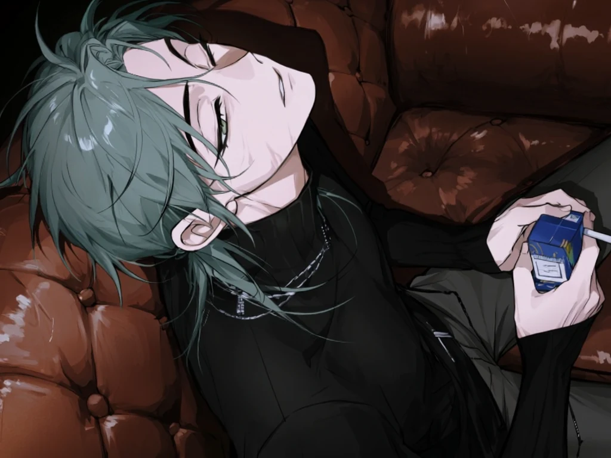</a><br/><sub>On the sofa</sub></td>
</tr>
<tr>
<td width="33%" align="center"><a href="docs/readme/gallery/inline-microphone.webp">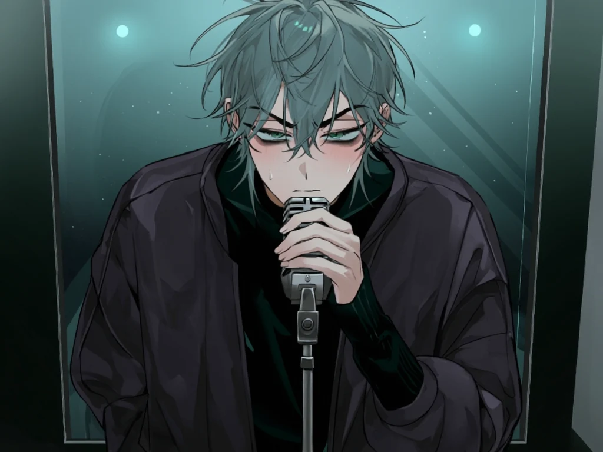</a><br/><sub>At the microphone</sub></td>
<td width="33%" align="center"><a href="docs/readme/gallery/inline-sleep.webp">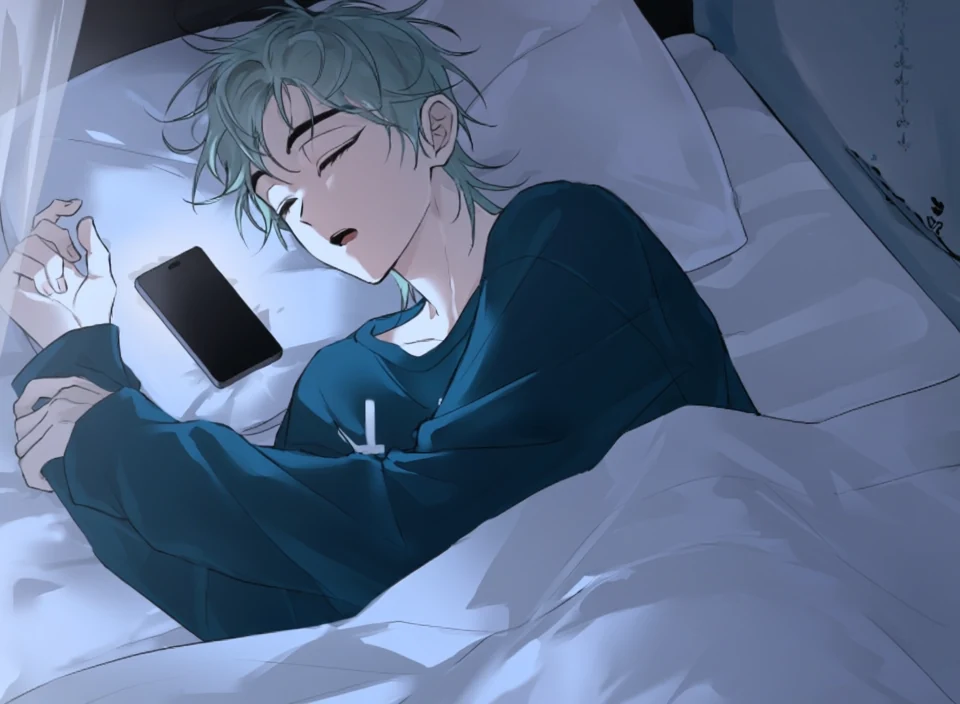</a><br/><sub>Asleep beside the phone</sub></td>
<td width="33%" align="center"><a href="docs/readme/gallery/inline-screen.webp"></a><br/><sub>Blue-screen portrait</sub></td>
</tr>
</table>

<sub>Click any image to view it larger. See the [Studio artwork gallery](docs/readme/gallery.md) for additional illustrations, earlier work and processing examples.</sub>

### Model-aware prompting

Studio understands structured subject ownership, scene composition, explicit character counts, visual identity binding and model-specific prompt dialects. Auto resolves the known checkpoint's authoring guidance before the request is compiled. Manual family choices are also available.

| Family | Available approaches |
| --- | --- |
| Anima | Native hybrid tags/prose, Aesthetic, experimental regional conditioning |
| Illustrious | Booru-oriented prompts and regional conditioning |
| MOSS | Caption, Swarm bounding boxes, native layout JSON |
| Krea 2 | Descriptive natural-language captions |

Inspect the original request, compiled positive/negative prompts and recorded diagnostics from the image's context menu. Optional grouped count reinforcement accepts explicit Booru count tags for compatible families. These helpers improve conditioning; they do not guarantee exact composition or eliminate identity bleed.

[Compiler guide](docs/prompt-compilers/README.md) · [Auto authoring](docs/prompt-compilers/auto-authoring.md) · [Count reinforcement](docs/prompt-compilers/explicit-count.md)

### Visuals & Lore

- **Character and persona Visuals:** save visual identities, appearance prompts, reference bindings, LoRA stacks, checkpoint preferences and named Looks.
- **Visual Lore:** organize reusable character, creature, location and other visual knowledge in native lorebook folders, including model-specific overrides. Scene-scoped selection keeps unrelated identities out of requests.
- **Manual Lore:** select eligible saved visual identities for manual generation and inspect their provenance in Generate.
- **Pocket integration:** compatible Pocket builds can explicitly request resolved Studio visual context through the [Pocket visual bridge](POCKET-VISUAL-BRIDGE.md).

[Visuals workspace](docs/visuals-workspace.md) · [Visual Lore Atelier](docs/visual-lore-atelier.md) · [Manual Lore](docs/prompt-compilers/manual-lore.md)

## Cast your story

Cast is a reusable library of actors, outfits, facial expressions and scenery. Bind an album to a conversation and use its visual assets in dialogue without generating an image for every line.


<sub>Actual Studio-produced artwork supplied by the project author. Expression variants preserve a shared character identity and casual outfit.</sub>

### Expression Studio & Wardrobes

Create or import an expression pack, choose an identity and outfit prompt, and select the expressions to produce. The workshop supports a configurable generation recipe, optional references, upscale, background removal and local despill. Import external images or ZIP packs into empty slots without overwriting existing artwork.

Wardrobes let a single member own multiple outfits, each with its own reference and expression collection. Move existing expressions between outfits without duplicating image files. The member retains their identity and presentation preferences. Historic dialogue keeps its authored wardrobe keys.

**Alpha.16:** create or switch appearance sets directly in Expression Studio. Fresh sheets and settings-only copies keep existing artwork intact; named alternate slots keep additional takes. Each wardrobe saves its workshop rendering overrides independently. [Wardrobe workshop guide](docs/wardrobe-workshop.md).

**Alpha.17 — Character library:** link an existing character into several casts to share wardrobe collections, expression art, identity and per-outfit workshop settings. Cast direction (presentation, crop, side, packet prefix and preferred starting wardrobe) remains local. Fork independent characters, copy a single outfit into another existing member, or restore uncast characters without losing image references. [Cast Registry guide](docs/cast-registry.md).

**Alpha.17.3: Cast-local wardrobe visibility.** Hide or show an outfit in one cast without changing shared artwork or availability elsewhere. Global archive and removal remain separate. [Wardrobe lifecycle guide](docs/wardrobe-lifecycle.md).

**Alpha.17.2: Wardrobe management.** Archive and restore populated outfits, or permanently remove their mappings with linked-cast confirmation. Image files remain untouched. [Wardrobe lifecycle guide](docs/wardrobe-lifecycle.md).

[Expression Workshop](docs/expression-workshop.md) · [Cast Recipe](docs/cast-recipe.md) · [Wardrobes](docs/cast-wardrobes.md)

### Cast Genesis: let the story grow its own ensemble

Genesis is an opt-in automation for new characters introduced during roleplay. A completed creation packet can reserve a member, ask the configured text sidecar for one reusable visual identity, and send it through the existing expression pipeline.

```xml
<swarm-cast=mina flag=create expression=joy>"You two are hopeless."</swarm-cast>
```

Choose Basics (6 expressions) or Full spread (20), automatic or review-first design, prompt-only or supported neutral-reference anchoring, and a per-reply production limit. Jobs run in the backend, deduplicate repeated requests and preserve successful expressions if a later slot fails. The user controls the production budget, not the RP model.

**Do not save** retains the registered final Lumi expression assets and permanent Cast member while reducing unnecessary intermediate retention. Custom processing workflows may still create Swarm-side files. As expressions become available, historical dialogue can hydrate without rewriting the original message.

[Genesis setup, resume and retention](docs/cast-genesis.md)

### Cast presentations & Member Atelier

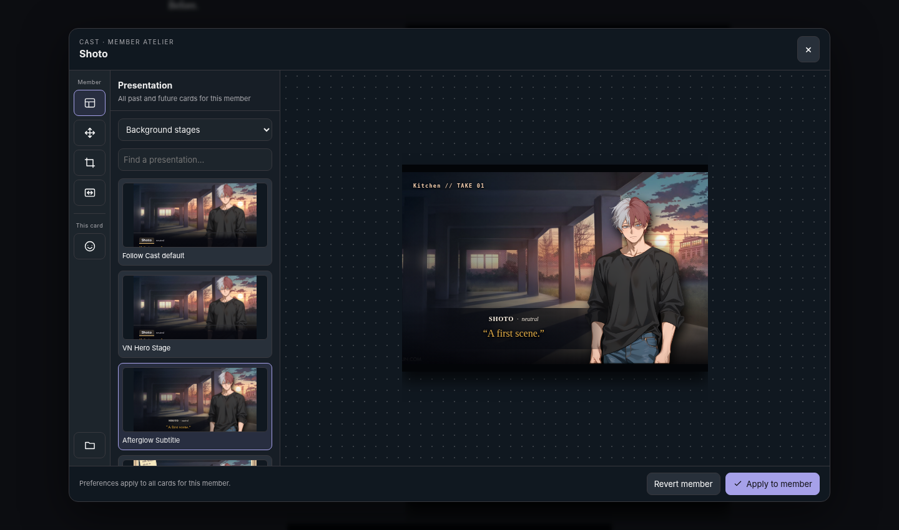

Choose from 50 named visual presentations, including VN stages, portrait overlaps, graphic panels, standees, editorial layouts and scene-backed designs. Character artwork, authored dialogue and speaker color remain separate from the surrounding narrative.

Member Atelier provides a visual presentation picker and contextual transformation controls. Change stage side, scale, position, crop and desktop card width as personal member preferences; correct an incorrect expression for a single card without altering the written dialogue or the portable album defaults.

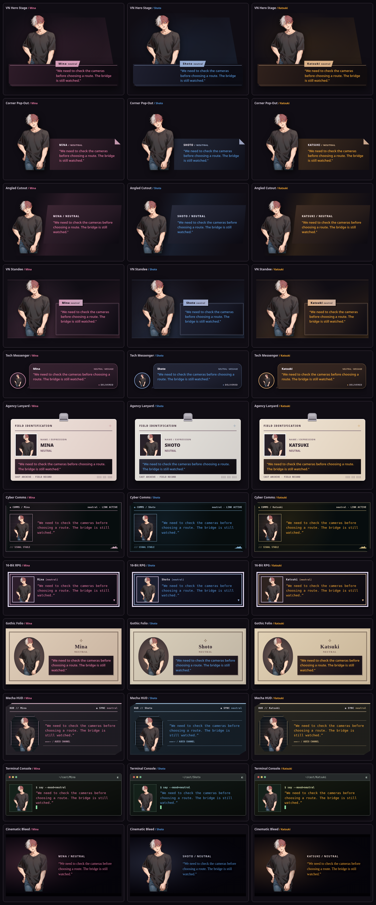

<sub>Presentation family samples from an earlier design audit.</sub>

The latest overlap refinements widen long dialogue, retain transparent OVA subtitles and distinguish paper, telemetry and capsule materials without replacing authored dialogue colors. [Overlap refinements](docs/cast-overlap-refinement-alpha1711.md).

[Cast guide](docs/cast.md) · [Member Atelier](docs/member-atelier.md) · [Presentation library](docs/presentation-library.md)

### Worlds & Atmospheres

Save shared locations in a Cast album or generate scenery from opted-in completed replies. Reuse locations across characters, export backgrounds to a reusable Library folder, and update a scene without duplicating assets.

Atmospheres add optional palette washes, scenery grading and independent actor tint. Dawn, moonlight, memory, tension and custom colors change the look of a scene without rerendering its artwork. Motion is optional and off by default.

```xml
<swarm-cast=shoto-amusement wardrobe=default background=kitchen atmosphere=moonlight>
  <font color="#72B9FF">"I thought you'd say that."</font>
</swarm-cast>
```

These are bounded dialogue packets: narration outside the closing tag remains ordinary prose. The keys refer to saved album assets; choose real keys from your Cast.

**Background Workshop:** open Cast → Backgrounds → Generate to create a location with inherited or manually overridden checkpoint, sampling, canvas, seed, negative prompt and LoRA stack. Preview the candidate and accept or veto it before registering it in both the Cast and reusable Background Assets. Veto leaves the ordinary saved output intact; pending reviews survive closing the modal, not a backend restart.

<table><tr><td width="50%">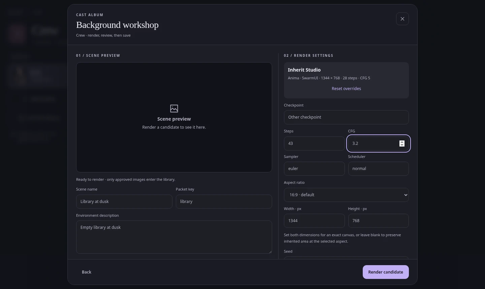</td><td>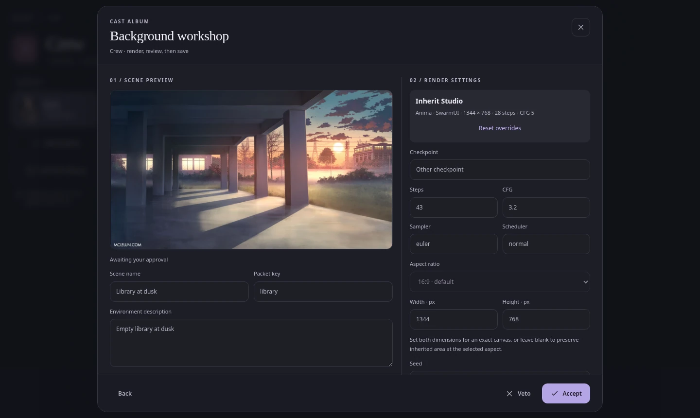</td></tr></table>

[Cast Worlds](docs/cast-worlds-v1.md) · [Dynamic backgrounds](docs/cast-background-generation.md) · [Atmospheres](docs/cast-atmospheres.md)

## Story Theater

**Play your roleplay as a visual novel, then continue writing without leaving the stage.** Story Theater uses the conversation, Cast expressions, scenery, inline illustrations and authored HTML you already have. Open it from the Studio drawer or the floating toolkit's more-tools menu.

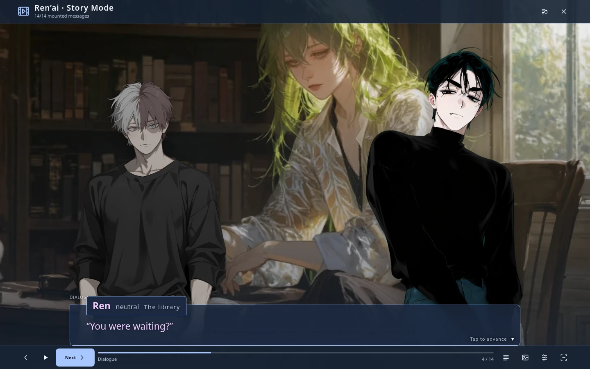

<sub>Alpha.17.12 compiled Chromium capture with supplied artwork and a mocked Lumiverse host.</sub>

### Four ways to tell the story

- **Narration:** paragraph-by-paragraph reading, preserved inline colors, configurable typography and animated text reveal.
- **Cast dialogue:** keep your authored graphic cards or stage compatible actors as independent sprites with bottom-anchored dialogue. Expressions and scenery persist through narration; inactive actors can dim, desaturate or recede. Rewinding reconstructs the captured scene rather than showing future expressions.
- **Event CGs:** give inline illustrations their own fullscreen composition, with optional framing and a dedicated gallery.
- **HTML islands:** preserve supported authored CSS, SVGs, typography and local disclosure controls in isolated, scrollable screens. Host actions are not replayed.

<table><tr><td width="50%">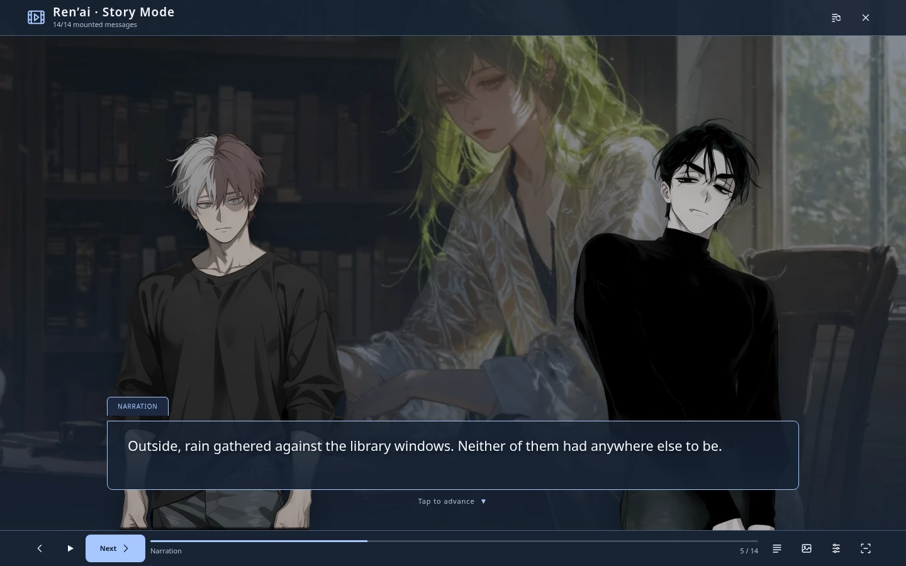</td><td>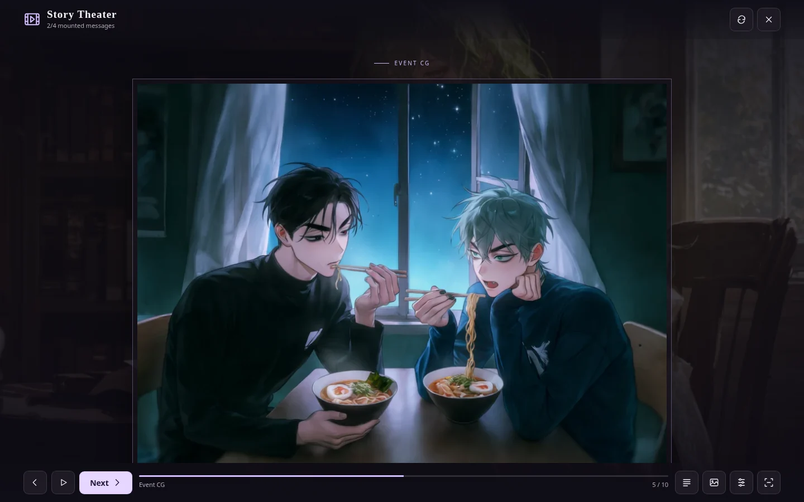</td></tr></table>

[Playback guide](docs/story-theater.md) · [HTML island validation](docs/story-theater-html-validation.md)

### Art direction & Theater Atelier

Choose from nine built-in looks, including the original Theater. Each has its own visual language for narration, dialogue, CGs and navigation. Preview the four screen types, adjust tokens, save custom looks, and apply them globally or to an individual conversation.

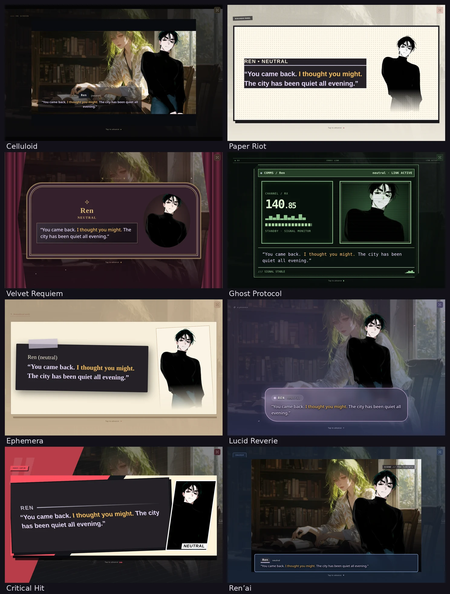

| Look | Style |
| --- | --- |
| Ren’ai | Classic visual novel, independent sprites and grounded dialogue |
| Celluloid | Film framing, intertitles and restrained subtitles |
| Paper Riot | Manga panels, ink and halftones |
| Velvet Requiem | Ornamental theatrical folio |
| Ghost Protocol | Phosphor Codec portraits, transmission interface and signal monitor |
| Ephemera | Scrapbook, photographs and journal pages |
| Frosted Reverie | Localized translucent frost and soft stage framing |
| Critical Hit | Bold diagonals, pop-art accents and graphic cut-ins |
| Original | The original Theater presentation |

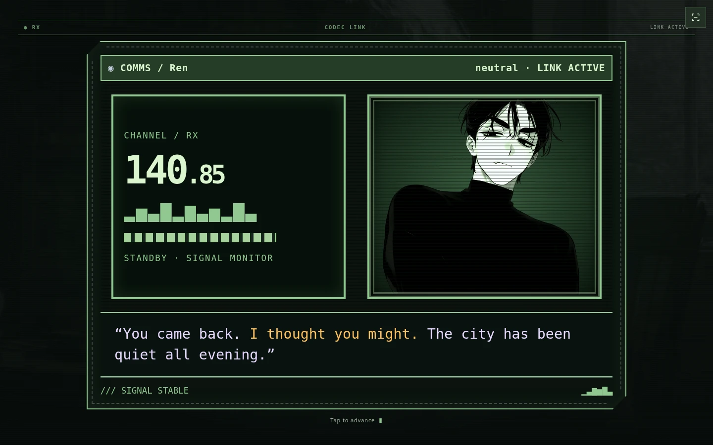

The **Cast** inspector can keep each actor's presentation, use the Theater look's recommendation or temporarily override everyone with one of the 50 Cast templates. Compatible scenic cards can use native full-viewport staging; authored graphic cards can dock to the bottom instead. Independent dialogue, scene label and actor sizing preserve the visual hierarchy. These overrides never change the saved Cast album.

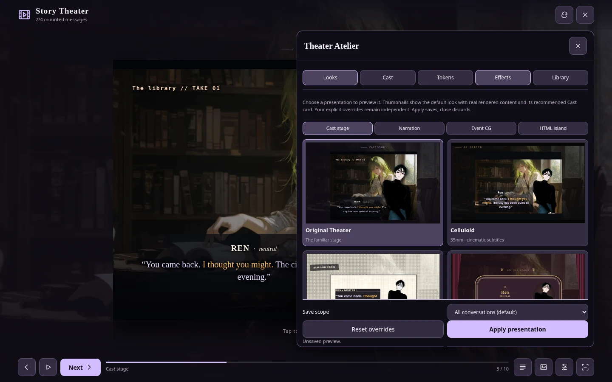

[Art direction and token guide](docs/theater-art-direction.md) · [Stage geometry](docs/story-theater-density-validation.md) · [Mobile look comparison](docs/readme/theater-art-mobile.webp)

### Stagecraft: actors, scenery, lighting & effects

The stage has independent controls for actors, background, lighting and atmospheric effects. Use the quick settings shortcuts to enter the relevant inspector directly; preview appearance changes before applying them.

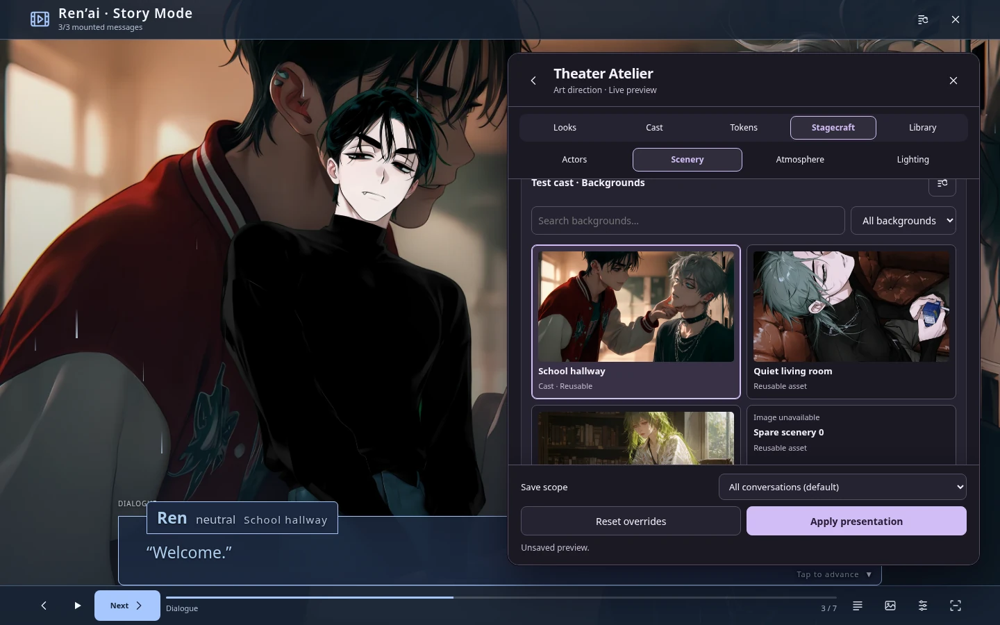

- **Actors:** retain the last known expression, control inactive actor emphasis and clear the stage when needed.
- **Scenery:** follow the story's location, browse saved Cast locations and shared Background Assets, or choose one of nine local SVG patterns as a fallback, replacement or overlay. Manual saved-image selections can last for the current scene or be pinned for the Theater session. Adjust fit, zoom and focal point independently.
- **Lighting:** follow story-directed moods and Cast atmosphere cues, or select a manual palette with independent strength and actor tint. Scene grading does not require a new image generation.
- **Weather & stage FX:** persistent rain, snow, fog, petals, embers, dust, leaves, fireflies and wind; finite actor-targeted effects such as sparkles, impact and lightning. Manual overrides, intensity, motion preferences and reduced-motion support are independent of the look.

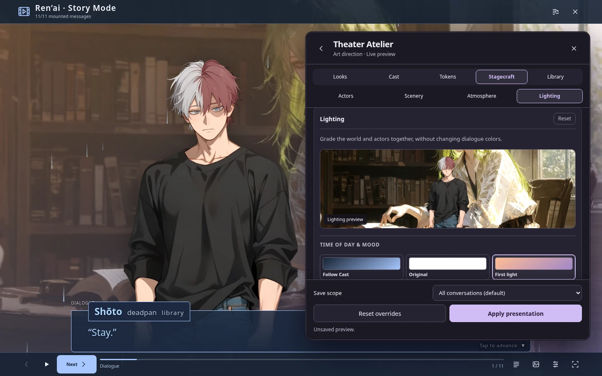

[Stagecraft](docs/theater-stagecraft.md) · [Scenic direction](docs/theater-scenic-direction.md) · [Weather and FX](docs/theater-fx.md)

### Stage Direction: let the story direct the scene

Enable the optional protocol in **Studio settings → Stage Direction**. Choose global, Cast or chat scope, the allowed capabilities, frequency and prompt placement. Use automatic injection or macro mode; the static before-history protocol is stable across appended messages when its configuration and location catalog are unchanged.

```text
[[scene: kitchen]]
[[lighting: moonlight]]
[[atmosphere: rain intensity=45]]

Rain whispered against the windows.

[[stage-fx: sparkles target="Shōto" intensity=65 duration=1000]]

He smiled.
```

Standalone cues work with narration or any dialogue presentation. Valid cues are consumed by the display projection and outgoing assistant history cleanup while raw saved messages retain them for replay. Use actual saved location and supported lighting keys. Optional missing-location production uses the existing Cast background generator after a complete saved reply, subject to its limits and permissions. Manual Theater overrides take precedence while active.

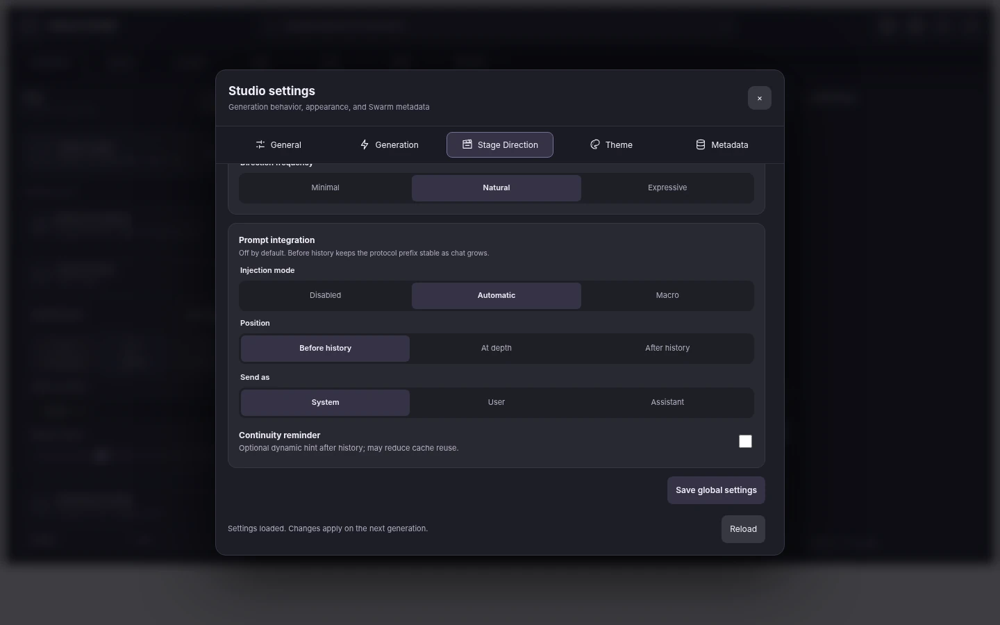

[Stage Direction setup, syntax, macros and caching](docs/stage-direction.md)

### Keep playing, keep writing

Interactive Theater uses the native Lumiverse composer, reply generation, stop, regenerate and swipe commands. Newly completed paragraphs, Cast packets and closed HTML islands can become playable as they arrive; uncertain transformations wait for the saved response. A themed waiting screen may show provider-exposed reasoning when available.

<table><tr><td width="50%">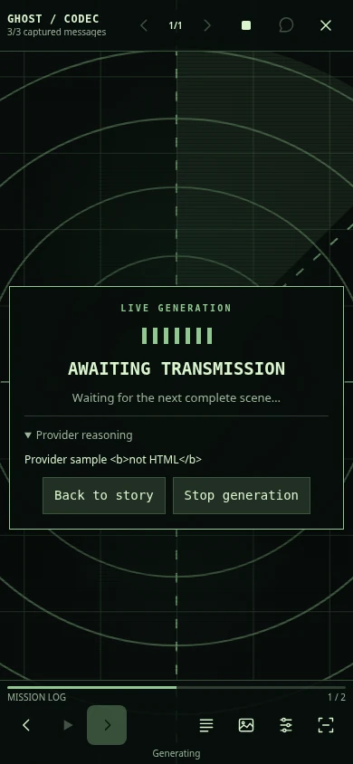</td><td>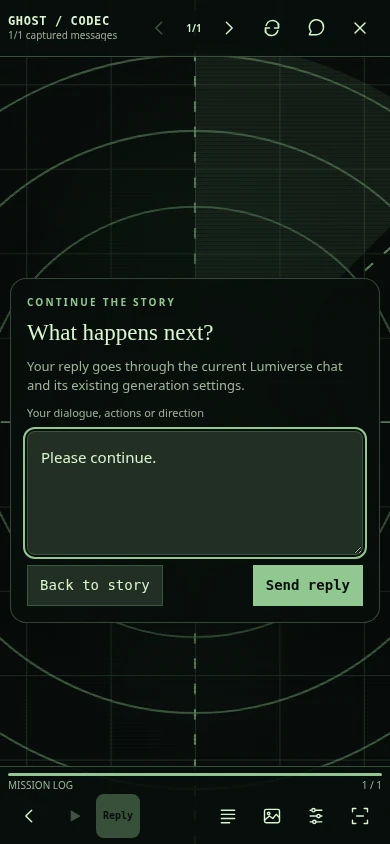</td></tr></table>

Tap or use keyboard navigation to complete an animated text reveal, then advance. Autoplay waits for the reveal to finish. Hide controls for a clean stage, switch swipes, revisit the message-grouped scene index, or jump directly to an illustrated event from the CG gallery. Reading position and appearance preferences are remembered locally.

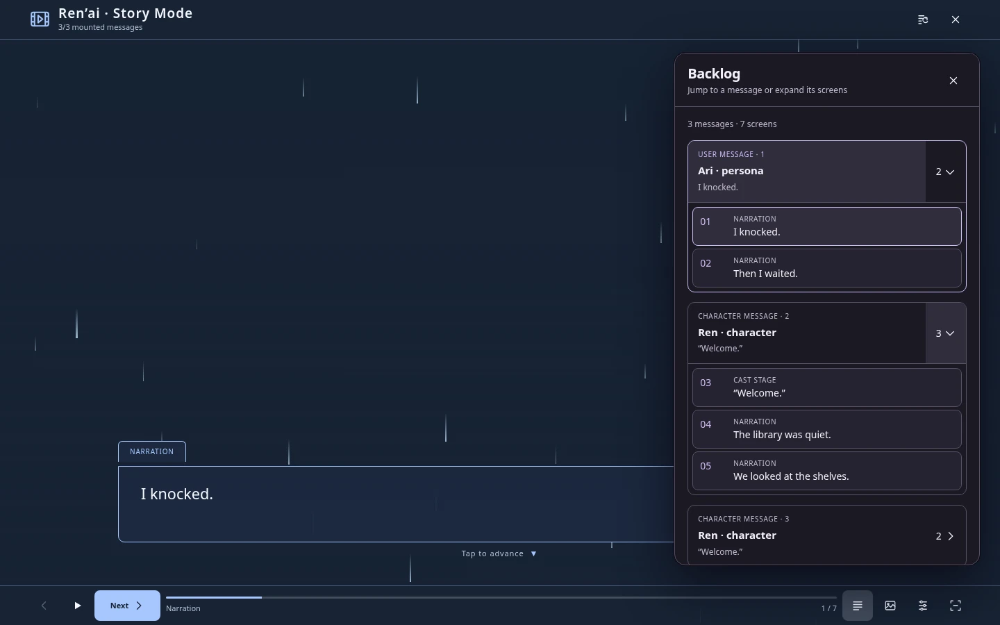

[Interactive Theater](docs/story-theater-live.md) · [Transport controls](docs/story-theater-transport-validation.md)

**Scope and compatibility:** Theater captures Lumiverse's mounted conversation window and retains captured snapshots while open; it cannot reconstruct unvisited virtualized history. Exit, scroll to another part of the conversation and reopen to capture that window. Ordinary playback does not request generation or rewrite chat. Explicit native reply, swipe, regeneration and stop actions are separate. On hosts without the required native composer and message APIs, Theater remains read-only. Manual scenery pins reset when Theater closes; saved looks are browser-local. See the [validation reports](docs/story-theater-validation.md) and [live playback validation](docs/story-theater-live-validation.md) for fixture coverage and live-host limitations.

## Postproduction

### Edit: correct the artwork, not the entire scene

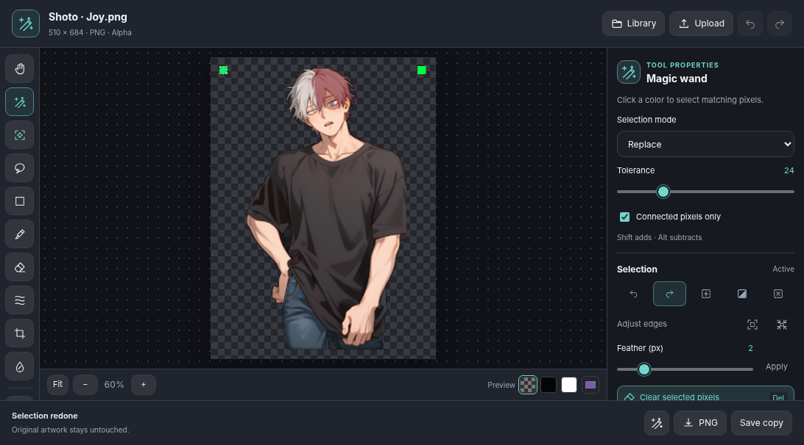

The local editor includes brush/eraser, transformations, crop, liquify push, magic wand, selection history, feathering and color despill. Combine manual selections with AI-assisted masks, then use them for local edits or transfer a selection to Inpaint.

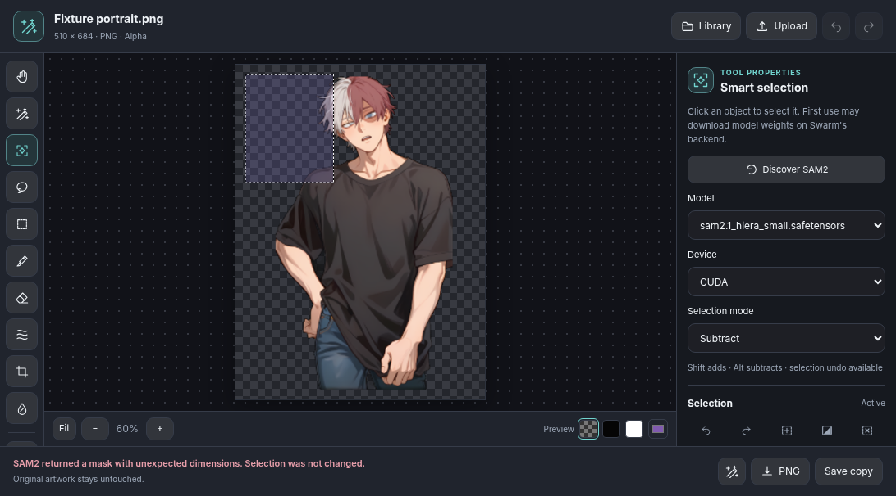

**Smart Selection** uses a compatible SAM2 installation to produce a mask from a click on the artwork. Replace, add or subtract selection masks, undo, refine edges and preserve the original source until you explicitly apply an edit. This release uses point-based segmentation, not text-prompt segmentation.

[Studio Edit guide](docs/studio-edit.md) · [Smart Selection requirements](docs/postproduction.md#smart-selection-in-edit)

### Finalize: reusable processing chains

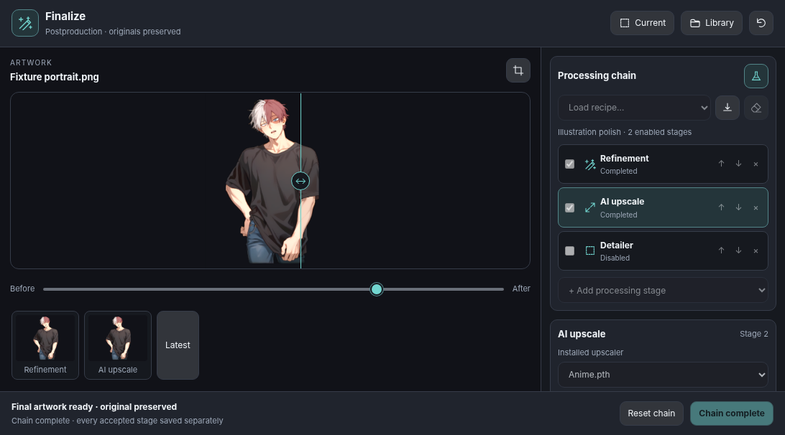

Send an image from the Library, inspector or Edit into a finishing chain. Configure and reorder stages before starting, compare the original and current result, and save your setup as a reusable recipe.

| Stage | Purpose |
| --- | --- |
| Refinement | Low-creativity img2img at a chosen resolution, with optional Anima reference guidance |
| AI upscale | Installed model-based upscalers, 2–4× |
| Detailer | Detector-driven local refinement with supported checkpoints and detector weights |
| Background removal | Existing BiRefNet cutout pipeline |
| Despill | Local green/blue edge cleanup |

Each completed stage saves a separate derivative with parent provenance. Cancel or retry a failed stage without deleting earlier results. Four editable starter recipes cover illustration polish, expression finishing, environment polish and surgical correction. Current chains run while Studio is open; they are not durable background jobs and do not yet replace automated Cast/Genesis/inline finishing configurations.

### Render Lab: compare before you commit

<table><tr><td width="40%" align="center">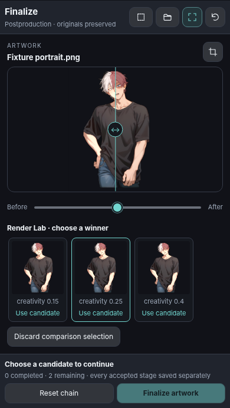</td><td><strong>Same source. Same seed. One variable.</strong><p>Compare two to four values of creativity, sampling steps, text CFG, reference guidance or guidance end. Choose the candidate you prefer and continue the remaining stages with that image. The chosen value can become part of your saved recipe.</p><p>Unselected candidates remain in your Library until you decide what to do with them.</p></td></tr></table>

[Full postproduction guide](docs/postproduction.md) · [Validation report](docs/postproduction-validation.md)

## Library, provenance & Vacuum

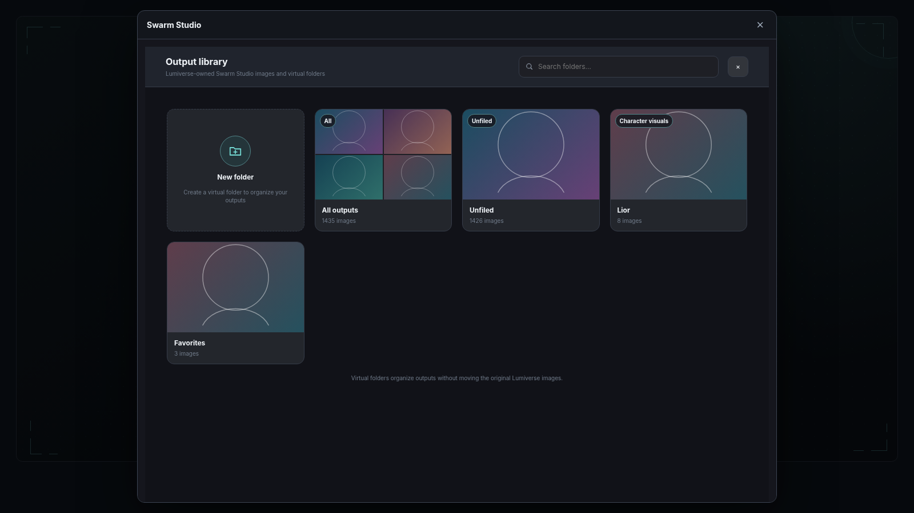

Browse All outputs, Unfiled, Favorites, character folders and custom collections. Reuse recorded parameters, inspect metadata, manage images in bulk, and preserve the original when creating derivatives. Library folders organize references rather than copying files unnecessarily.

Studio tracks asset lineage and current references so lifecycle decisions can distinguish a discarded draft from an image used by a Cast member, scene, chat or favorite. Vacuum provides metadata-aware cleanup review; check the reference coverage and proposed candidates before approving external cleanup. Swarm originals and Lumiverse copies are separate assets. Finalize also temporarily protects its source and candidates while the workspace is open.

[Lifecycle policy](docs/lifecycle-policy.md) · [Reference coverage](docs/reference-coverage.md) · [Metadata and Vacuum foundations](docs/metadata-vacuum-v1.md)

## Compatibility and provider setup

Core generation uses the SwarmUI connection you already configured in Lumiverse. Optional tools discover installed provider capabilities where possible. Studio does not silently install custom node packs or checkpoints.

| Feature | Optional requirement |
| --- | --- |
| Live preview | Lumiverse streaming generation API and provider previews |
| Inline automation | Host message/tag interceptors and enabled protocol |
| Parser / Genesis design | Configured Lumiverse text connection (local models are welcome) |
| Anima reference guidance | [Anima Ref Adapter](https://github.com/ArcAnima/ComfyUI-Anima-Ref-Adapter) and compatible models; `ref_end` requires a compatible version |
| Smart Selection | [Kijai SAM2 nodes](https://github.com/kijai/ComfyUI-segment-anything-2) and model availability; the provider loader may fetch missing model weights |
| Detailers | [Impact Pack](https://github.com/ltdrdata/ComfyUI-Impact-Pack), [Impact Subpack](https://github.com/ltdrdata/ComfyUI-Impact-Subpack), compatible detector weights; built-in graph currently supports Anima and Illustrious |
| Upscale | Installed Swarm upscale models, or configured compatible workflow |
| Background removal | Compatible BiRefNet workflow |

Dynamic workflows need a compatible Swarm backend and sufficient permissions. Provider detection is not proof that a graph will execute on every installation. See [provider requirements and current input limits](docs/postproduction.md#provider-requirements).

Lumiverse manages actual generation credentials. If Swarm requires authentication for metadata browsing, Studio supports a separate encrypted metadata-only token scoped to the configured origin. Unavailable optional host integrations do not intentionally disable the core workspace.

## Documentation

| Guide | Contents |
| --- | --- |
| [Full technical reference](docs/feature-reference.md) | Setup, permissions, protocols, macros, workflows, metadata, troubleshooting; some layouts are historical |
| [Prompt compilers](docs/prompt-compilers/README.md) | Family modes, identity binding, composition and transport |
| [Visual Lore](docs/visual-lore-atelier.md) | Lore navigation and identity authoring |
| [Cast](docs/cast.md) | Albums, expressions, deployment and dialogue rendering |
| [Cast Recipe](docs/cast-recipe.md) | Shared art direction and generation settings |
| [Genesis](docs/cast-genesis.md) | Automatic production and recovery |
| [Wardrobes](docs/cast-wardrobes.md) | Multiple outfits and asset migration |
| [Cast Registry](docs/cast-registry.md) | Shared characters, safe linking, forks and outfit copying |
| [Member Atelier](docs/member-atelier.md) | Shared preferences vs individual expression correction |
| [Dynamic backgrounds](docs/cast-background-generation.md) | Automatic and manual scene creation |
| [Atmospheres](docs/cast-atmospheres.md) | Grading, lighting and motion |
| [Edit](docs/studio-edit.md) | Pixel operations, masks and AI tools |
| [Story Theater](docs/story-theater.md) | Fullscreen playback, controls and rendered-window limitations |
| [Interactive Theater](docs/story-theater-live.md) | Live playback, composer and native transport |
| [Art direction](docs/theater-art-direction.md) | Visual looks, tokens and Theater-only Cast overrides |
| [Scenic direction](docs/theater-scenic-direction.md) | Saved scenery browser and scene index |
| [Stage Direction](docs/stage-direction.md) | Optional scoped prompt protocol, cues and macros |
| [Weather and FX](docs/theater-fx.md) | Persistent atmosphere and one-shot effects |
| [Stagecraft](docs/theater-stagecraft.md) | Actor persistence, SVG scenery, atmosphere and lighting |
| [Postproduction](docs/postproduction.md) | Finalize, Render Lab, reference controls and SAM2 |
| [Lifecycle policy](docs/lifecycle-policy.md) | Retention, provenance and protection |
| [Changelog](CHANGELOG.md) · [Archived README](README-history.md) | Release history and earlier documentation |

## Development

The extension manifest loads the checked-in compiled bundles. Rebuild after source changes (Node.js 23.6+ for the build):

```sh
npm install
npm run build
npm run typecheck
npm test
```

Targeted postproduction and Theater checks:

```sh
npm run test:postproduction
npm run test:postproduction-ui
npm run test:theater
npm run test:theater:art
npm run test:theater:stagecraft
npm run test:theater:live
npm run test:inline:stream
npm run test:theater:scenery
npm run test:stage-direction
```

The UI diagnostics require Python Playwright, Pillow and Chromium. See [the validation report](docs/postproduction-validation.md) for the exact tested scope and blocked suites. Mocked browser and backend fixtures verify application behavior and provider requests, not live GPU quality or every installed node version.

## About the artwork and screenshots

The illustrations, inline CGs and expression art above were generated using Studio, as supplied by the project author. The [artwork gallery](docs/readme/gallery.md) also includes pre-standalone work, explicitly labeled. The current Theater and Background Workshop screenshots were captured from the compiled Alpha.17.12 frontend with a mocked host/provider. Earlier presentation galleries and Studio screens are retained as illustrative captures from previous releases; some use supplied art and others use fixture images. They illustrate the interface, not independently verified live GPU results.

<div align="center">
  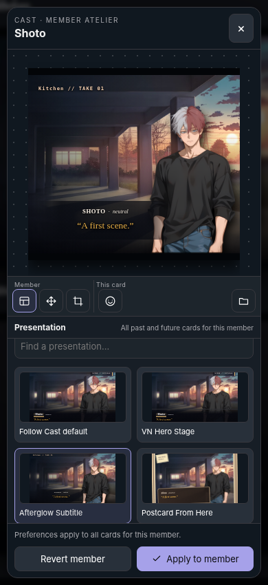
  <p><strong>Built for the space between a generation and the story it belongs to.</strong></p>
  <sub>MIT licensed · LumiSwarm Studio is an independent Lumiverse extension. Lumiverse and SwarmUI are separate projects.</sub>
</div>
