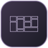
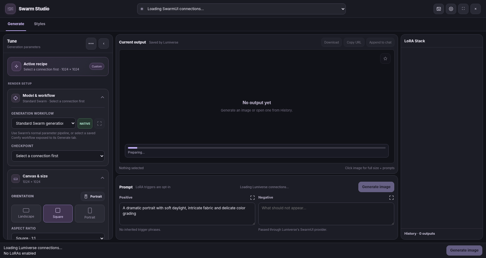
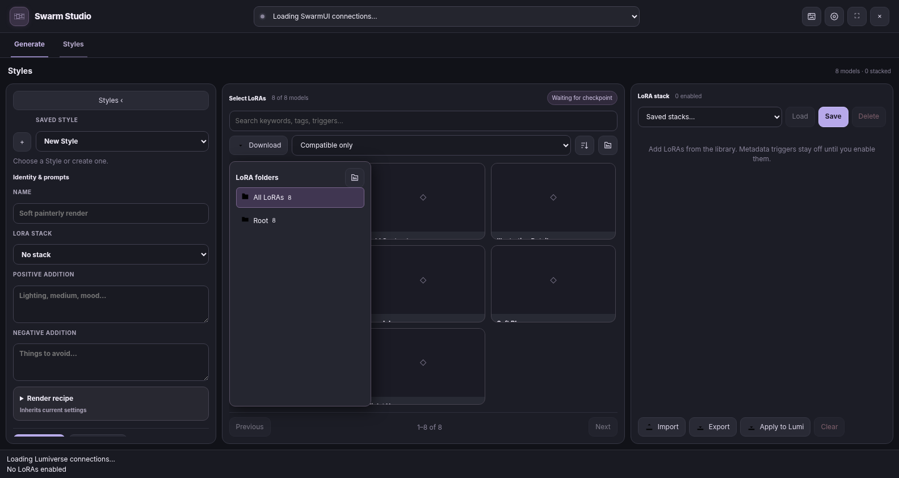
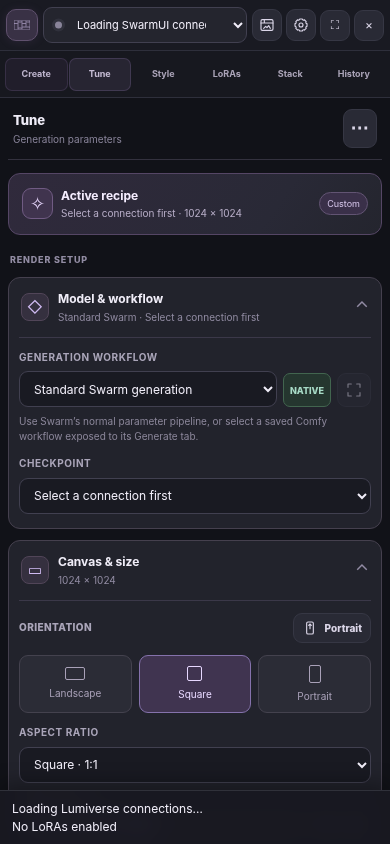
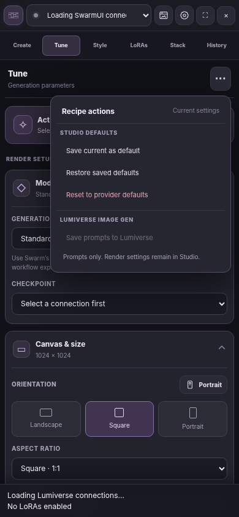

<div align="center">
  
  <h1>Swarm Studio</h1>
  <p><strong>Your SwarmUI workspace, right inside Lumiverse.</strong></p>
  <p>Prompt, tune, stack LoRAs, browse generations, and bring images into your chats—without switching applications.</p>
  <p><code>Spindle extension</code> · <code>Lumiverse 0.15.8+</code> · <code>SwarmUI / ComfyUI workflows</code></p>
  <p><a href="#installation"><strong>Install</strong></a> · <a href="#the-studio"><strong>Explore the studio</strong></a> · <a href="#what-it-does"><strong>Features</strong></a> · <a href="#documentation"><strong>Documentation</strong></a></p>
> **Quick Create (v18):** the lower-right Locket opens a compact Action Rail and artwork-first Composer. Right-click/long-press the orb or use `⋯` to open its shared context menu. See [v18 repair notes](LIVE_CHECK_V18.md).

</div>

---



<sub>Generate workspace · Actual v4 interface captured with an offline browser fixture. Connection-dependent content is unavailable in this preview.</sub>

Swarm Studio adds a full image-generation workspace to [Lumiverse](https://github.com/prolix-oc/Lumiverse) using the SwarmUI connection you already configure there. It **does not replace** Lumiverse's native inline image tools or take ownership of your saved connection secret.

## The studio

### Generate: the controls you need, where you need them

A three-part workspace keeps the **Tune** inspector, current output and prompt composer, and **LoRA stack** in view. Tune groups the real controls by task rather than presenting one endless settings form:

- **Model & workflow** — checkpoint selection, standard Swarm generation, and saved ComfyUI workflow parameters.
- **Canvas & size** — orientation presets, aspect ratios, linked dimensions, and scale.
- **Sampling & quality** — steps, CFG, seed, sampler, and scheduler.
- **Image-to-image & Advanced Swarm** — init images, denoise/creativity, preset stacks, model overrides, and raw request JSON when you need them.

The little **⋯** menu collects Studio defaults, character recipe actions, and Lumiverse prompt exports without burying the everyday controls beneath them. It preserves their different save/restore behavior.

### Styles: reusable looks and a real LoRA library



<sub>Styles workspace · The LoRA library and the active stack stay separate, so browsing never silently changes your generation.</sub>

Build named Styles with positive and negative prompt additions, optional render settings, and a selected LoRA stack. Browse compatible LoRAs, inspect metadata and previews, enable or reorder weights, opt into trigger phrases, and import/export shareable stacks. You can apply a stack to Lumiverse Image Gen as well.

### Output Library: your generations, properly organized


<sub>Output Library v10 · Offline browser fixture with 1,435 simulated outputs. Your own images and folders appear in the live extension.</sub>

The library keeps every original saved image in Lumiverse. Browse **All outputs**, **Unfiled**, **Favorites**, and virtual character or custom folders with bounded cover previews. Open a folder for a paginated, independently scrollable thumbnail grid; image details, favorites, bulk selection, and character Looks remain accessible. At phone widths, folder cards and image thumbnails use a two-column layout.

### Phone-sized without throwing away your work

<table>
  <tr>
    <td align="center" width="50%"></td>
    <td align="center" width="50%"></td>
  </tr>
  <tr>
    <td align="center"><sub><b>Tune on mobile</b><br />Compact cards, tappable controls, and preserved draft state.</sub></td>
    <td align="center"><sub><b>Recipe actions</b><br />Save and restore operations without an accordion maze.</sub></td>
  </tr>
</table>

The mobile studio uses **six persistent tabs:** **Create · Tune · Style · LoRAs · Stack · History**. Switching tabs preserves prompt drafts, loaded LoRAs, and other in-progress settings. The image-to-image picker lives in **Create** on narrow screens, and Generate remains within easy reach.

## What it does

| Create & iterate | Keep images organized | Bring visuals into Lumiverse |
| --- | --- | --- |
| Positive/negative prompts, checkpoints, sampler, scheduler, CFG, seed and aspect controls | Chat-scoped history, output details, reuse parameters, favorites and folders | Append finished images to chat, per-character visual bindings, named Looks and Visuals controls |
| Live previews and interrupt support when Lumiverse exposes streaming | Full-size inspection, verified Swarm-path downloads when available, original metadata preservation | Optional `<swarm-image>` message tags, one-pass or parser-model image requests |
| img2img and saved SwarmUI/ComfyUI workflows | Searchable LoRA library, weighted stacks and portable JSON | Quick Create floating player, Lumiverse Image Gen stack handoff, `{{last_genned}}` macro |

The Studio also includes metadata-aware LoRA downloading, stack presets, native prompt editors, customizable appearance, and visual lore integration on supported Lumiverse builds. For the precise behavior and integration requirements, see the [full feature reference](docs/feature-reference.md).

## Installation

**Before you start:** You need Lumiverse **0.15.8 or newer**, a working **SwarmUI image-generation connection** in Lumiverse, and permission to enable a Spindle extension. ComfyUI workflows are accessed through SwarmUI's saved workflow interface; a separate direct ComfyUI connection isn't required for Studio.

1. In Lumiverse, open **Extensions / Spindle** and install Swarm Studio from its GitHub source or an extension archive/folder.
2. Enable **Swarm Studio** and approve the requested permissions. The manifest lists them in [`spindle.json`](spindle.json).
3. Confirm your existing **SwarmUI** connection works in Lumiverse. When no explicit URL is set, Lumiverse's default is `http://localhost:7801`.
4. Open **Swarm Studio** from its drawer entry or the chat input's **Extras** menu. Pick a checkpoint, enter a prompt, and generate.

**Using a source ZIP?** The package includes the compiled `dist/frontend.js` and `dist/backend.js` expected by Spindle; you do **not** need to build it just to install it. For a manual replacement, back up the existing extension directory and extract the complete source over it. Restart/reload Lumiverse as appropriate for your installation.

If a previous GitHub-source installation failed partway through, stop Lumiverse and remove the incomplete `data/extensions/swarm_studio` directory before retrying. See [GitHub source installation notes](docs/feature-reference.md#github-source-installation).

## A few useful details

**Generation and authentication.** Image creation continues through Lumiverse's SwarmUI provider. Streaming uses `spindle.imageGen.generateStream()` when available, with a non-streaming fallback. Lumiverse's connection secret is never exposed to the extension; if SwarmUI restricts *metadata* access, Studio supports a separate encrypted metadata-only token in Settings.

**Connected features vary.** LoRA previews, checkpoints, saved presets, workflows, and original-file downloads depend on the APIs and metadata your SwarmUI server exposes. Character-editor Visuals integration and automatic in-message image interception require the corresponding Lumiverse host capabilities. Core Studio generation remains available when optional integrations are missing.

**No surprise downloads.** Importing a LoRA stack does not automatically download its missing models; transfers require an explicit action.

## Documentation

| Guide | What's inside |
| --- | --- |
| [Full feature & technical reference](docs/feature-reference.md) | Image-tag protocols, authentication, LoRA downloading, character looks, output library, macros, workflow parameters, and runtime behavior |
| [Studio workspace architecture](docs/experimental-studio.md) | Source map, mobile pane ownership, host integration, and browser diagnostic notes |
| [v4 redesign notes](REDESIGN_V4_README.md) | What changed in the source-aware visual rebuild and which checks were run |
| [Changelog](CHANGELOG.md) | Detailed feature and compatibility history |

## Development

The checked-in bundles are the runtime entrypoints. **When editing source**, rebuild them before packaging or committing:

```sh
# Node.js 23.6+ for the source build
npm run build

# For development/testing, install the declared dev dependencies
npm install
npm test
npm run typecheck
```

The package has no runtime dependencies. The optional browser suite is `npm run test:browser`; interactive UI diagnostics may require a configured Chromium/Playwright environment and suitable host fixtures. Debug messages use the `[Swarm Studio]` prefix in browser and Lumiverse server consoles.

---

<div align="center">

**Built for the space between a generation and the story it belongs to.**

<sub>Swarm Studio is a Lumiverse extension. SwarmUI and Lumiverse are separate projects.</sub>

</div>
