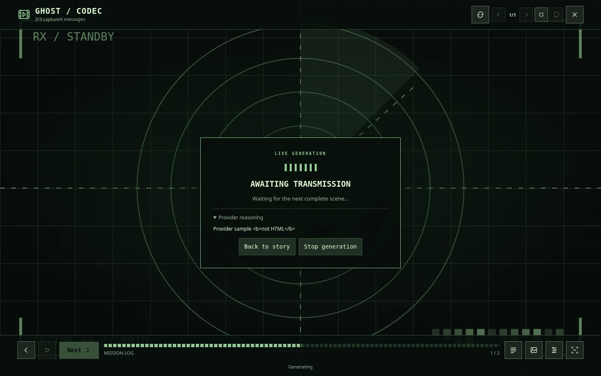
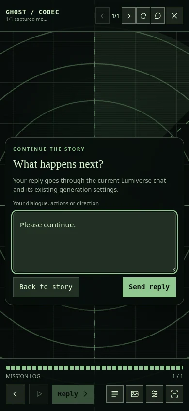

# Interactive Theater (Alpha.14)

Story Theater can now continue an active Lumiverse conversation without leaving its fullscreen presentation. It is an alternative view of the host's chat, not a separate roleplay engine.

## Using the live stage

- At the last available screen, **Reply** opens the composer. The speech-bubble icon in the header jumps to the reply surface. The native chat tail must be captured and its composer mounted.
- The text is the actual native composer draft. Type, then choose **Send reply** (or Ctrl/Cmd+Enter) to submit with the host's existing persona, connection, preset and generation settings. The first completed assistant screen opens automatically. Back to story permits reading earlier captured screens during generation.
- The waiting interlude inherits the active Theater presentation. Expand **Provider reasoning** only when the provider supplies a separate reasoning stream. It is rendered as inert text, held in memory, and cleared on completion/chat switch. It is not fabricated or extracted from hidden reasoning.
- At the playback edge, **Wait** waits for another completed screen. More screens can append while the reader stays on the current one. A final unclosed paragraph becomes available from the saved response. Late Cast and CG hydration uses the host projection.
- Previous/next swipe controls in the header operate on the latest assistant reply (not the current story screen). Right at the final swipe can request a new native swipe, matching Lumiverse. Regenerate requests another response for the latest assistant turn. Stop invokes the host's stop action. Controls are guarded during known active generation and reconciliation. Story Back/Next navigate screens only.

Screenshots are compiled Chromium fixture captures, not a live provider session.

## Transport and authority

The extension was checked against the supplied Lumiverse staging source, commit `429fac455909a4ae3207d478714503f7cd13c391`. It uses `ctx.composer.getState`, `setText`, `send`, `onChange`, `ctx.messages.getRecent`, `getContent`, `listMessageIds`, `ctx.dom.listMessageElements` and `ctx.host.surfaces.list/invoke`. Commands: `action-regenerate`, `action-stop-generation`, `action-swipe-left`, `action-swipe-right`. The swipe commands delegate to the host's shared `executeSwipe` hook. Existing manifest permissions cover the actions. No core changes are included.

The stream accumulator consumes scoped `GENERATION_STARTED`, `GENERATION_IN_PROGRESS`, `GENERATION_PHASE_CHANGED`, `STREAM_TOKEN_RECEIVED`, `GENERATION_ENDED` and `GENERATION_STOPPED` events. Separate text/reasoning buffers validate character offsets; duplicates can overlap exactly, while gaps stop progressive ingestion. Recovered streams without a complete prefix wait for canonical completion. Background swipes/impersonation do not replace the foreground sequence.

A source scanner recognizes closed paragraphs, closed top-level HTML and complete Cast packets. The scanner only grants eligibility; the extension projects the actual native rendered message DOM, retaining existing regex, sanitization, Cast, and media processing. The text-only comparison is deliberately conservative, not a second Markdown or regex engine. Incomplete HTML cannot be accepted merely because the browser has balanced its tags. Ambiguous transformed text or unknown media waits for the final native render, and may hold subsequent content in that response to maintain ordering.

Canonical message IDs and selected swipe indices drive a session-local snapshot cache. Reconciliation waits for matching stored content and stable DOM snapshots; replaced swipes invalidate the affected response and rebuild the downstream actor/scenery timeline. Unmounted captured messages remain available for this open Theater session. Chat changes close and clear the view. No separate persistent message store or additional provider requests are made by playback.

## Compatibility and boundaries

- If the composer/message APIs are missing, the legacy read-only player remains available. Missing host commands are hidden. A runtime with the staging-compatible API/event contracts is recommended; old runtime versions have not been live-verified.
- Never-mounted virtualized history is still inaccessible. The composer requires a mounted native composer and captured current tail, rather than guessing the target chat or scrolling the native UI automatically.
- The host may defer streaming display or use text-changing regex transforms, and there is no exact source-to-rendered-offset provenance in the current SDK. Those cases wait for the canonical render; the feature does not promise arbitrary regex islands can appear mid-stream.
- Reasoning is available only during the generation interlude/edge wait, only from the host's explicit reasoning channel. It is not saved by Theater.
- The current API has no dedicated full native busy-state query in the composer bridge. Generation lifecycle events guard the controls; host errors/absent confirmations require checking native chat. Unknown reconciliation is bounded and fails closed, with refresh/return-to-chat recovery. No automatic retry of a send or a generation command.
- Playback stays inert: actions inside copied HTML and Cast cards are not executable. The new explicit composer/transport controls are the only live interaction path.

See [validation](story-theater-live-validation.md) for the mocked-host test scope.
