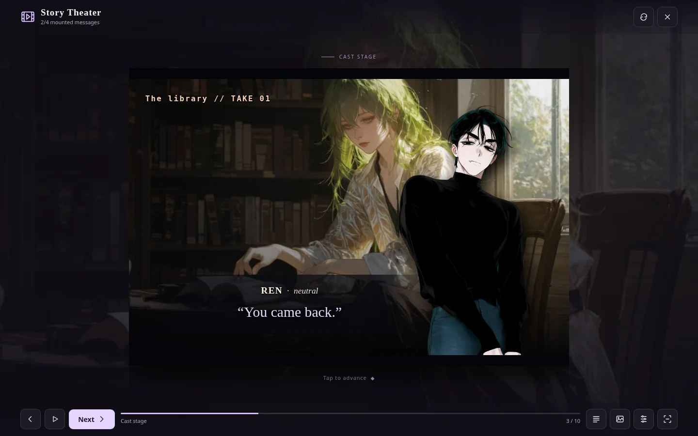
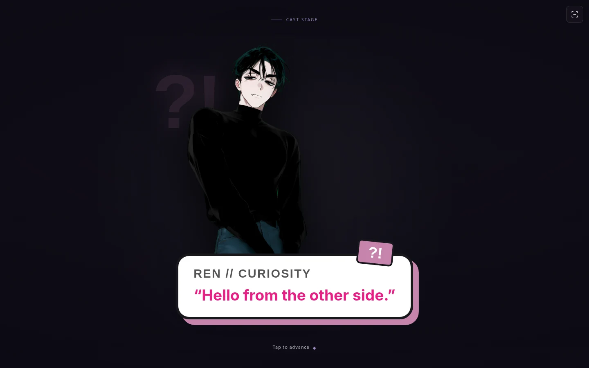

# Story Theater

A fullscreen presentation of the active conversation's rendered message window. Alpha.14 adds explicit native reply and response controls; ordinary playback stays read-only. See [Interactive Theater](story-theater-live.md) for live behavior, compatibility and boundaries.

## Enter the Theater

Open a chat, let its messages render, and choose **Story Theater** from the Studio drawer or the floating toolkit's more-tools menu. The fullscreen dialog reports how many messages are mounted out of the known chat history. The screen counter is separate: each message can produce multiple screens.

*Compiled Chromium screenshots with fixture artwork and a mocked host.*

| Screen | Behavior |
| --- | --- |
| Narration | Paragraph-by-paragraph reading, common inline emphasis, authored font colors and safe inline typography retained. Uses Theater typography rather than the chat's arbitrary prose CSS. |
| Cast stage | Existing rendered Cast template, dialogue, expression, side, crop and member/card adjustments. Pending Cast artwork can hydrate when the source card becomes available. |
| Event CG | Existing inline artwork, with optional editorial frame and gallery entry. |
| HTML island | Supported content and styles in an isolated shadow root. Native details and local checkbox/radio disclosures can expand; scripts, navigation, embedded frames, submissions and host actions are not replayed. |

The most recent Cast scene carries across subsequent screens and contiguous mounted messages. Unmounted gaps break continuity. No scenery is generated or inferred from prose.

## Playback

Tap a screen or use Next to advance. With text reveal enabled, the first tap or Next completes the current text immediately; the following input advances. Arrow Right and Space follow the same rule. Use Previous to go back. Arrow keys and Space navigate on desktop; H toggles the controls; Escape closes an open tools panel or exits. The backlog groups captured screens by message, using historical author names when available. Select the message heading to jump to its first screen, or expand its group to jump to an individual screen. The CG gallery jumps directly to artwork. Auto-play uses a configurable interval (2–30 seconds) after text finishes revealing, stops at the end, and pauses during generation or when opening tools.

Settings include Cinematic, Classic visual novel and Illustrated reading presentations, dissolve, fade through black, slide or cut, editorial or unframed CGs, and narration font size. Reduced-motion preferences are respected. Settings and the last screen key for up to 100 chats are stored in browser local storage, not in the portable Cast album.

## Theater polish settings

- **Cast stage size:** Fit to theater (default) scales each existing presentation as a whole using its native composition width and measured height, centered within the available stage. It does not change the saved member preference or actor alignment. Long captions may scroll rather than shrink. Original chat size restores the unscaled projection.
- **Text reveal:** Word by word (default), Typewriter, or Instant; Fast, Natural or Slow. Text remains in its final layout; the animation exposes existing text rather than requesting new model output. The current reveal survives same-frame refreshes and tool opening. Reduced motion uses instant text. Very long text (over 6,000 UTF-16 units) displays instantly to bound DOM size. HTML panels and event CGs appear normally.
- **HTML island surround:** Transparent (default), Glass or Solid. These affect only Theater's outer wrapper; the island's authored inner material is unchanged.
- **Inline markup:** Legacy font colors and safe inline CSS properties (color, background color, font weight/style, text decoration, text transform, letter spacing) are retained in prose. Layout and action attributes are not projected into narration. Host-sanitized markup cannot be recovered from the rendered DOM.
- **Advance prompt:** A short hint fades after entry/completion, leaving a pulsing diamond. The end-of-window message remains visible. Hidden controls reserve no layout space. The ambient layer supports independently selected, bounded CSS particles.

## Theater controls

The sliders icon opens a compact director console. Scenery, Atmosphere, Actors, Lighting, Cast cards and Looks open the corresponding Atelier section directly. Current scene settings are shown on the shortcuts. If a manual background is active, pin it or return to story scenery without opening the editor. The full Atelier remains available for detailed design and saved looks; its appearance edits still use the preview and Apply workflow.

Text reveal, speed and autoplay interval save immediately on this device. Infrequently used baseline settings (original presentation, transition, CG framing, narration size, Cast stage size and HTML surround) are grouped under the collapsed Presentation defaults disclosure. The active themed look can override baseline settings. Refresh rendered messages remains available at the bottom.

## Theater Atelier

Open Settings → Theater Atelier for eight distinct art directions, live previews, theme tokens, temporary Cast presentation overrides, compact scenic dialogue and scene-label sizing, and Stagecraft. [Stagecraft](theater-stagecraft.md) groups persistent actors, procedural scenery, atmosphere and lighting. See [Art direction](theater-art-direction.md) for the controls and limitations. [Scenic direction](theater-scenic-direction.md) adds saved backgrounds and grouped scene navigation.

## Scope and safety

Lumiverse's virtualizer mounts only a subset of the conversation. Theater captures that window and sorts it in host message order. It does not load, scroll or regenerate older history. To move to a different window, exit, scroll the original chat and reopen. Refresh re-captures currently mounted content; a saved position is restored when its screen still exists, otherwise playback starts at the beginning of the captured window.

A late-hydrating Cast card can refresh the projection when the same window remains mounted. A chat switch, edit, swipe or deletion closes playback to avoid stale projections. Live reply streaming and composing inside Theater are not implemented. If a host version exposes a message body that cannot be identified safely, that message is skipped and reported in the header. Custom HTML components requiring scripts, external styles or interactive state may not reproduce faithfully; use the original chat for interaction.

The source nodes remain in the chat. Theater copies permitted markup into its own dialog; it does not mutate message text, run HTML actions, dispatch backend generation, or create assets. No extra manifest permissions are needed. See [validation](story-theater-validation.md).
