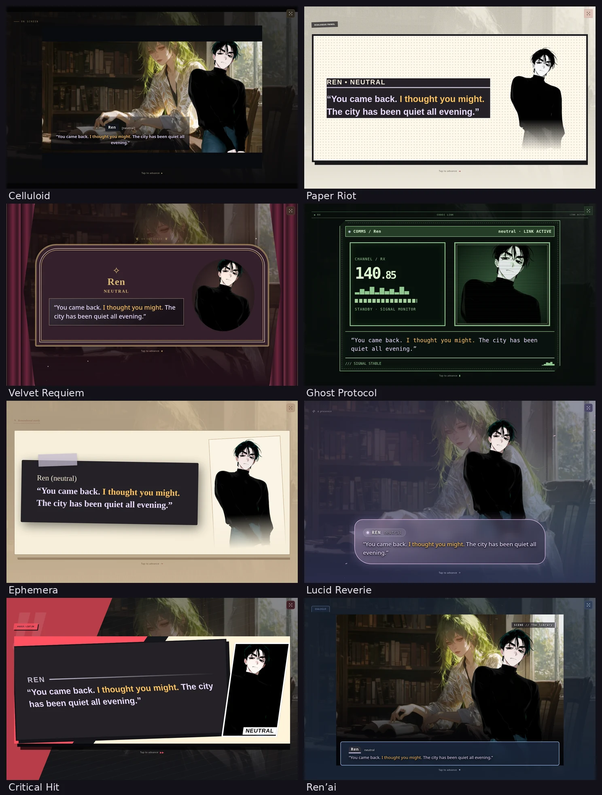
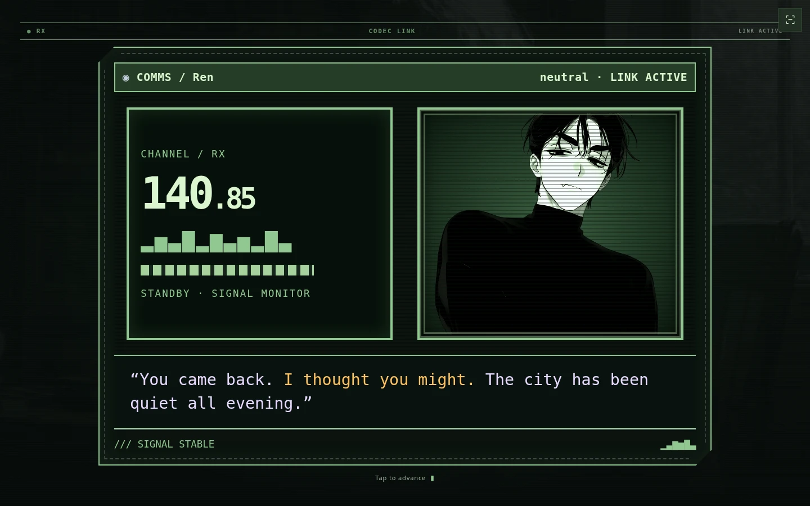

# Theater Art Direction · Alpha.13.2

Open Story Theater → Settings → Theater Atelier. The original look remains the default. The editor previews a draft in the active stage; use Apply presentation to persist it. Closing without applying discards the draft. The visual picker samples the currently available rendered content; preview types without a captured example use a fallback.

| Look | Recommended Atelier card | Visual treatment |
| --- | --- | --- |
| Celluloid | afterglow-letterbox | Film frame, intertitles, cinematic strip |
| Paper Riot | manga-frame | Ink, halftones, comic framing |
| Velvet Requiem | gothic-folio | Ornate theatrical folio, curtain transition |
| Ghost Protocol | cyber-comms | Phosphor Codec portrait, monitor, lower communication channel |
| Ephemera | washi-scrapbook | Journal, taped photos and page transition |
| Frosted Reverie | overlap-materia | Floating translucent composition, petals |
| Critical Hit | persona-comic | Bold diagonal graphic composition, slash transition |
| Ren’ai | vn-hero | Classic VN stage and grounded dialogue |

## Editor

- **Looks:** nine built-in options, including Original; preview narration, Cast, CG or HTML. Switching looks preserves explicit overrides.
- **Cast:** keep original cards (default), override with the preset recommendation, or choose another Atelier card. The override is local to playback. It re-renders available actor and dialogue data through the existing renderer, retaining identity, authored text/inline colors, expression, side, crop and compatible transforms. Template-specific decorations are not transplanted. Missing inputs fall back to the original card. Ghost Protocol's extra monitor is available with its recommended comms card; Stagecraft can replace it with a labeled last-seen portrait, not an inferred addressee.
- **Scenic sizing:** viewport fitting compensates for enlarged scenic labels and dialogue furniture independently of actor scale; overlapping expressive bubbles retain their normal geometry. The Cast tab has separate 60–140% dialogue and scene-label controls. Seamless scenery removes the embedded background on compatible world stages; not all card types support it.
- **Tokens:** palette (five editable colors), host palette option, font family, narration size, reading width, material radius/opacity, scene dimming/blur, independent narration layout, HTML surround, CG frame and transition. Host palette uses available supported six-digit hex tokens, falling back to the chosen palette for other formats. Authored colors and inner HTML styling retain priority. These controls affect Theater and supported card surfaces rather than arbitrary template CSS. Existing text reveal speed and playback settings remain available in the normal Settings panel.
- **Stagecraft → Atmosphere** (formerly Effects): preset default or independent rain, snow, petals, embers, dust or off. Intensity and animation are independent. Reduced motion stops animated particles. These are decorative CSS particles, not inferred weather, audio or simulated lighting.
- **Library:** save a named look (up to 40), preview or remove it, or export/import sanitized JSON. Save another name to duplicate. Section reset restores inherited defaults. Apply to all conversations or the current chat; up to 100 local conversation profiles. Storage is browser-local, not synchronized to the server or Cast album.

[Mobile gallery](readme/theater-art-mobile.webp) · [Validation](story-theater-validation.md) · [Theater playback](story-theater.md)

All captures are compiled Chromium fixtures with existing sample artwork and a mocked host. Theater still reads the mounted message window. No new backend calls, permissions, generated assets or source chat edits. Live host verification remains necessary.

Alpha.13.3 adds the [Stagecraft inspector](theater-stagecraft.md) with persistent actor controls, nine procedural scenery designs and backdrop lighting.

## Alpha.13.5 native staging

The Cast inspector offers Automatic (native for scenic compositions), Native (independent sprites for compatible hydrated cards), and Authored (original card projection). Authored cards default to bottom docking; disable docking to restore their prior alignment. Native staging uses the effective card's dialogue and source actor artwork, not a second embedded background. Actor focus is controlled by Stagecraft. Missing actor/dialogue inputs fall back to the authored card. The Tokens screen treatments offer narration placement (preset, bottom, center, left, right) and material (preset, soft gradient, transparent). Frosted Reverie retains the stable `reverie` ID; explicit saved token overrides continue to take precedence over new defaults.
