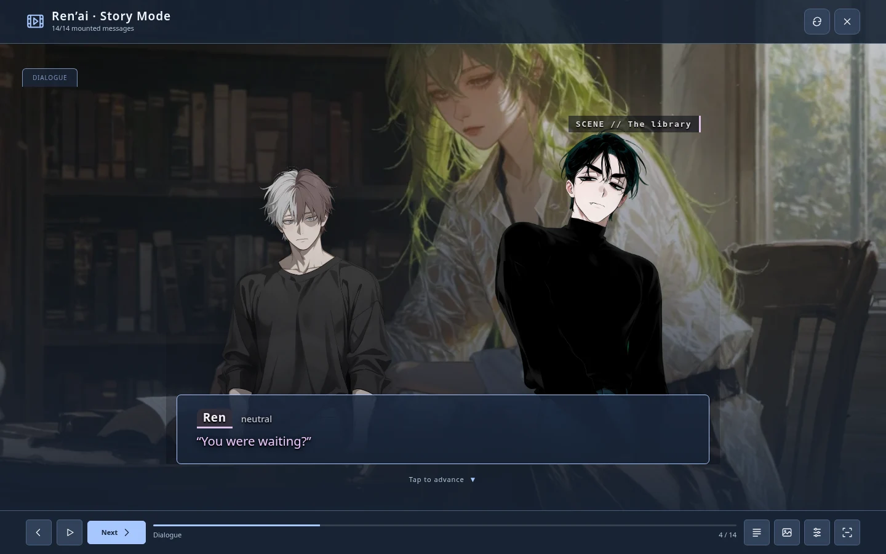
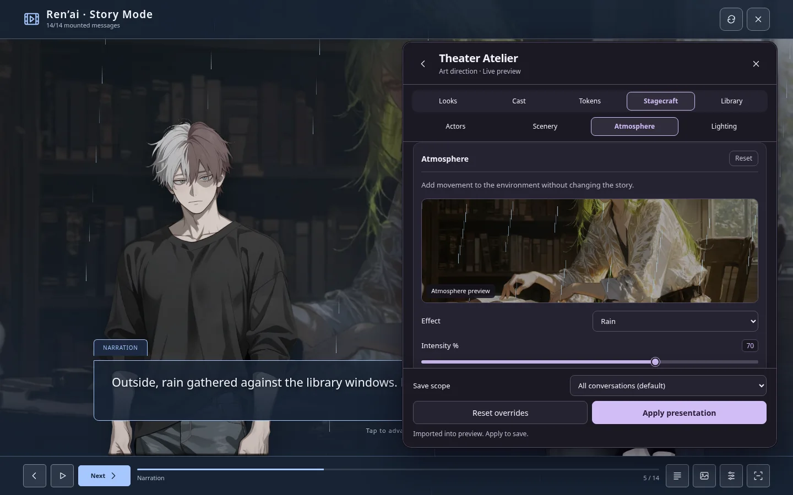
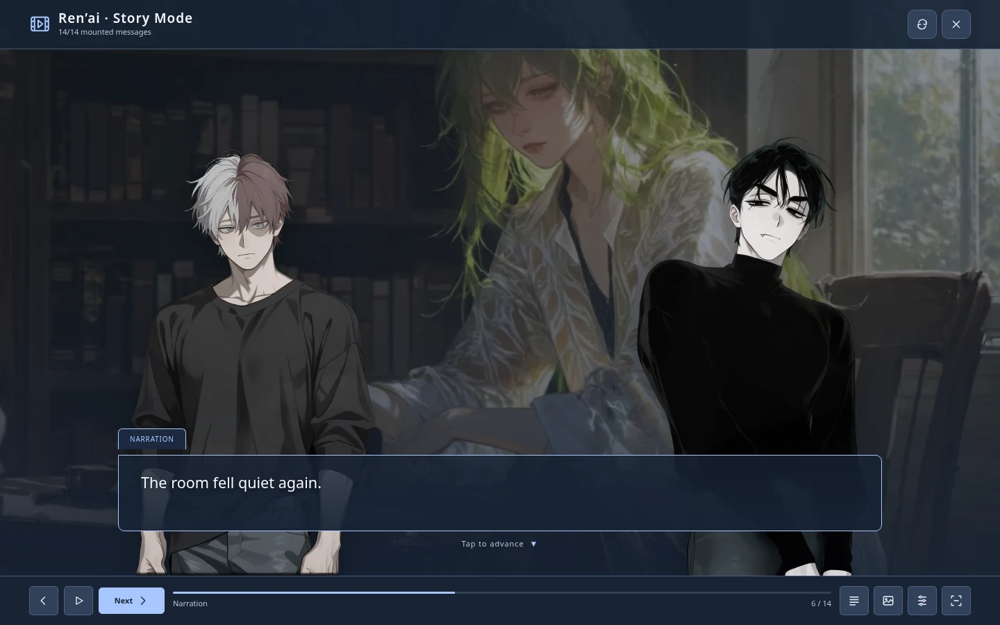
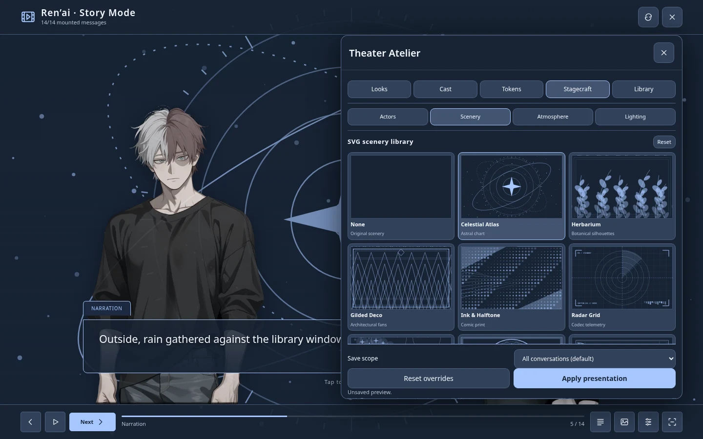
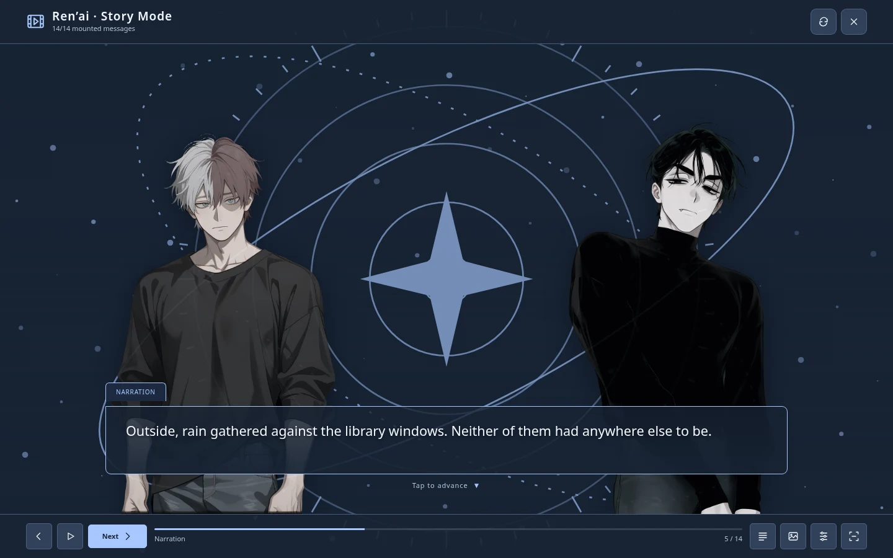
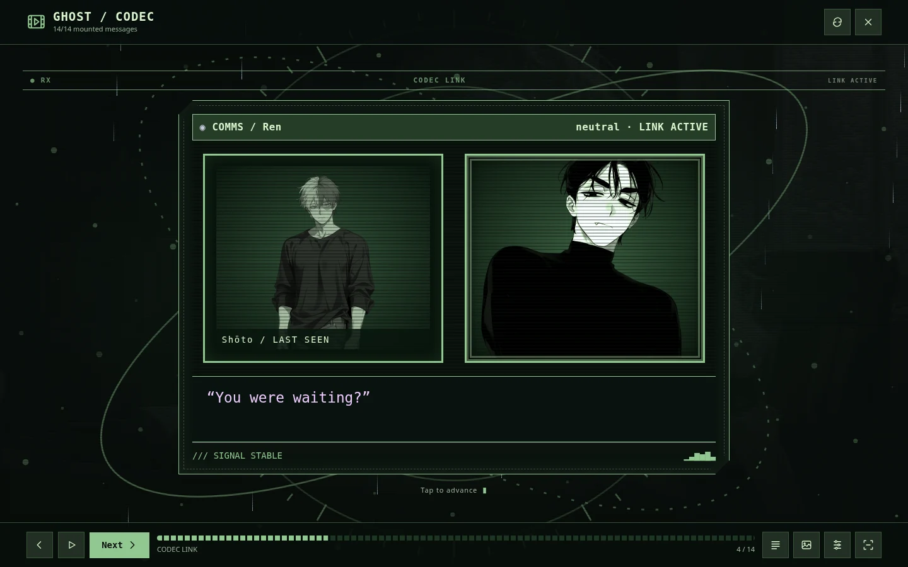

# Stagecraft · Alpha.13.3

Open Story Theater → Settings → Theater Atelier → Stagecraft. Actors, Scenery, Atmosphere and Lighting share the existing preview/apply workflow. Changes can be saved globally, per conversation or in a named look. Cancel discards unsaved presentation settings. Manual scene boundaries are session-only.

## Inspector polish (Alpha.13.4)

Stagecraft now uses an independent inspector palette, with pinned tabs and save footer, separated groups, labeled live values and miniature previews of the currently captured actor roster, scenery, atmosphere and lighting. Previews are local approximations of the stage, not additional generated art. The Cast tab includes searchable rendered card thumbnails. The story's palette remains untouched; the playback chrome uses contrast-safe colors. Desktop focus mode reveals an unboxed restore control when hovering the top-right target or focusing it by keyboard; touch devices retain a visible target.

## Actors

Ren’ai, Frosted Reverie and Ghost Protocol enable persistent actors by default; other looks can opt in. Theater records the last observed expression and image for each hydrated actor, using member identity where available. A maximum of four recent actors is tracked; choose a visible limit from one to four (two by default). Rewind reconstructs the roster from the earlier captured frames rather than retaining later expressions. Stable sprite nodes persist between consecutive narration screens. Inactive saturation (0–100%), scale (70–100%), opacity (0–100%) and emphasis motion are adjustable. Reduced motion disables emphasis transitions.

Compatible world-stage cards retain inactive actors alongside the original speaking card. Ghost Protocol's recommended Codec card can display the most recently seen inactive actor with a LAST SEEN label; it does not infer who is being addressed. Other presentations retain their individual geometry and show remembered actors during narration rather than forcing a second actor into the card. Event CGs and HTML islands temporarily hide the actor layer without clearing it. Explicit changes of scene, `none` scenery, and gaps between mounted messages clear the roster. Use **Clear cast here** to create a boundary at the current screen; **Undo clear here** removes that boundary. A speaker on that same screen can still appear. Theater does not infer entrances or exits from prose, and older cards lacking member IDs fall back to their normalized displayed names.

## Scenery

Nine locally generated SVG designs: Celestial Atlas, Herbarium, Gilded Deco, Ink & Halftone, Radar Grid, Shōjo Reverie, Rose Window, Manuscript and Mountain Ink. None preserves the original behavior. Select **Fallback** to fill an empty backdrop, **Replacement** to use the procedural design instead of generated scenery, or **Overlay** to combine them. Tint, pattern opacity and scale are adjustable. Compatible world cards expose the shared backdrop; other scenic templates can use the pattern through their existing background token, with template-specific layout and sizing. Original Cast art is not edited. Only fixed local SVG geometry and validated colors are used, not uploaded SVG markup or network URLs.

## Atmosphere and lighting

The existing rain, snow, petals, embers and dust controls now live in Stagecraft, including intensity and independent particle motion. Lighting collects brightness (20–150%), vignette (0–100%), dimming and backdrop blur. Pattern and atmospheric settings are independent of the selected look. These are decorative local visual effects, not weather simulation or automatic story inference. Lighting targets scenery, not the author's text or actor art; some embedded scenic compositions have their own materials.

## Scope

Theater remains a read-only projection of the mounted message window. It cannot reconstruct actors from unmounted messages or unhydrated art; a scene can remain populated until an explicit boundary or manual clear. The current speaking card still uses the original presentation rendering path. No backend calls, GPU generation, chat edits, new permissions or server-side synchronization. The Stagecraft-specific captures use the compiled frontend and a mocked Lumiverse host with sample artwork, not a live installation. See [validation](story-theater-validation.md).
